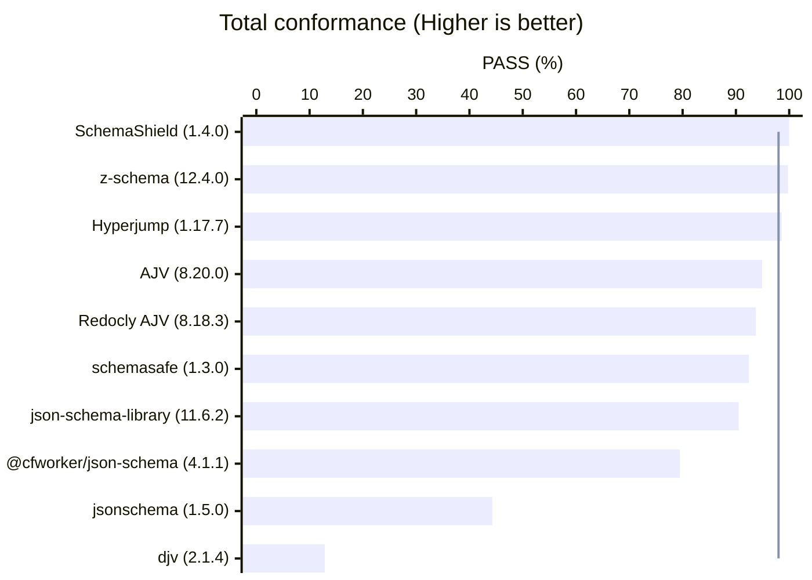
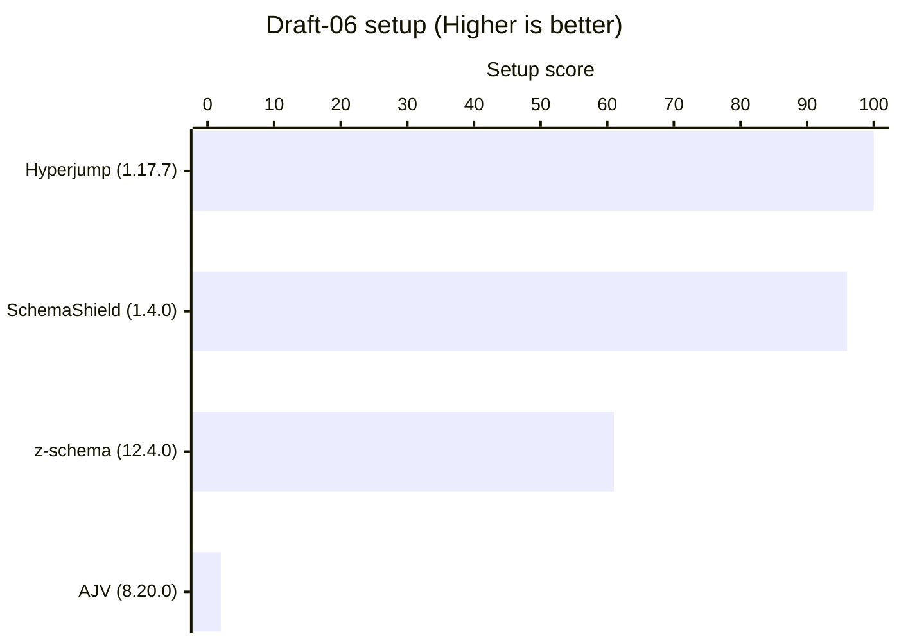
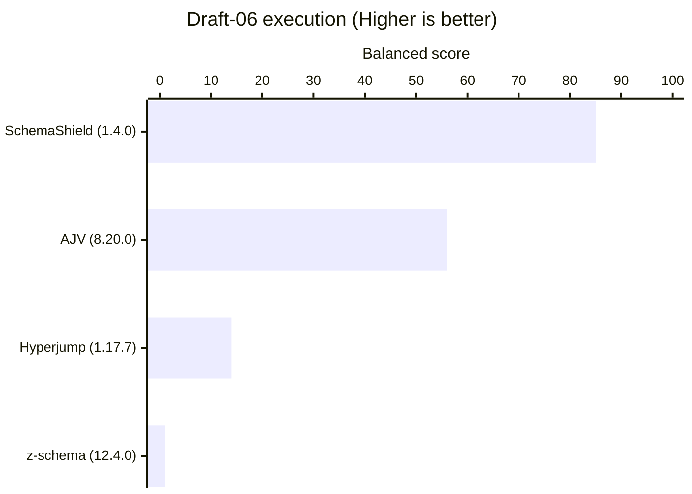
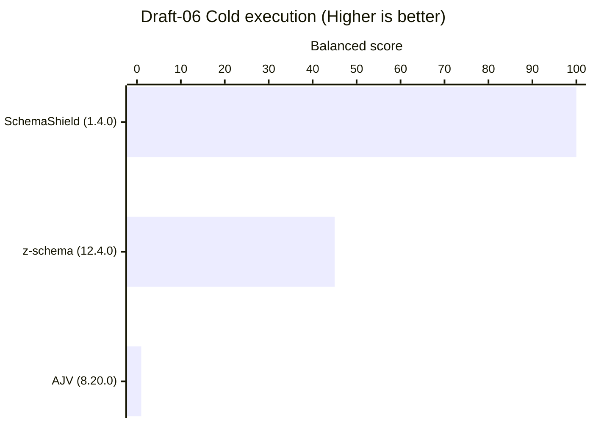
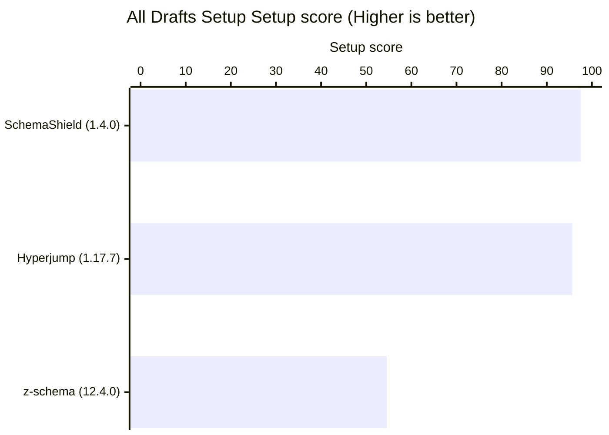
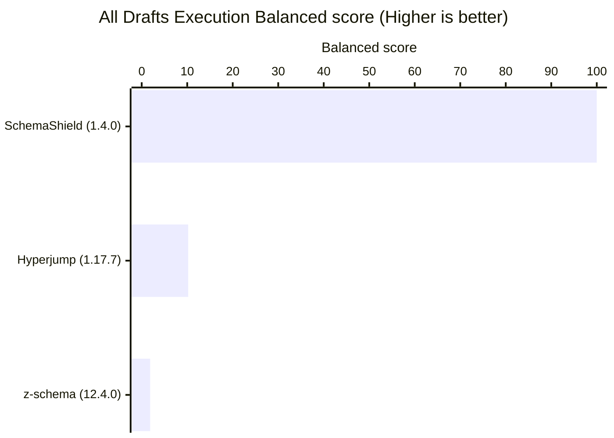
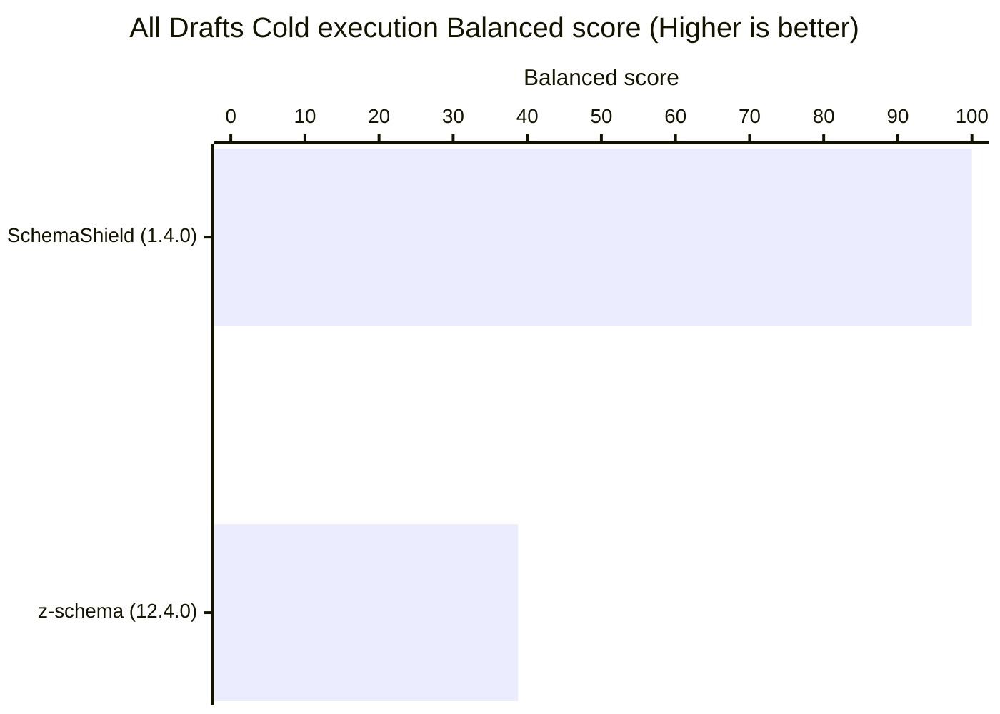
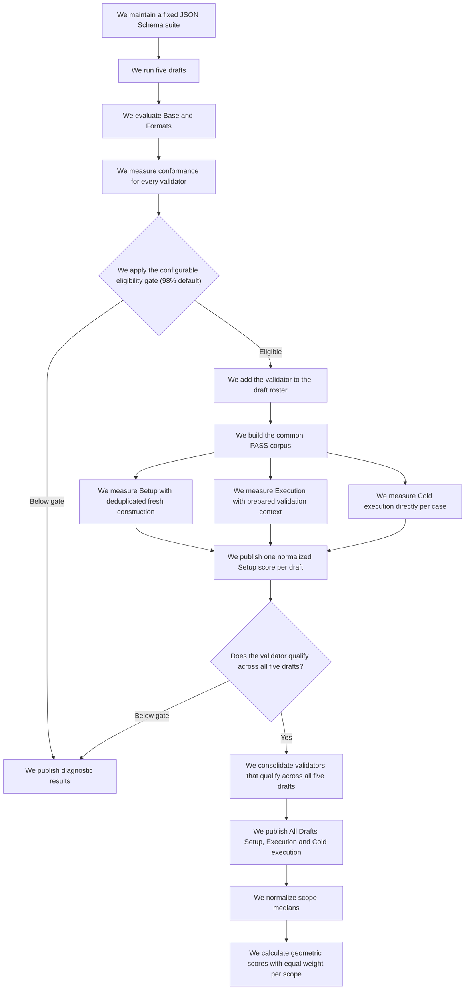

# JSON Schema Validator Bench

## Why

JSON Schema Validator Bench measures conformance and performance across drafts 04, 06, 07, 2019-09, and 2020-12 with pinned dependencies, corpus identities, and report contracts.

Maintainers can reproduce each run, inspect exact conformance records, compare qualified performance scopes, and use the results to target validator improvements.

## Install from a clone

Node.js 22 or later is required. From the cloned project root, install the exact dependency graph from `package-lock.json`:

```bash
git clone <repository-url>
cd <repository-directory>
npm ci
```

Replace `<repository-url>` and `<repository-directory>` with the clone URL and local directory name.

## Root commands

Use Quick for diagnostic change checks. Use Full for canonical publication results. A complete Full ignores existing performance checkpoints and measures every published sample in its current execution window.

Run the harness:

```bash
npm test
```

`package.json` is the source of truth for exact direct dependency versions. Adapter declarations define the required package inventory through `packageName` and `additionalPackages`. After changing a pin, update `package-lock.json`, then regenerate the derived npm metadata snapshot:

```bash
npm run metadata:sync
```

Run Quick:

```bash
npm run benchmark -- --quick
```

Refresh one validator against a compatible Full cohort:

```bash
npm run benchmark -- --validator <canonical-id>
```

Refresh one validator against a compatible Quick cohort:

```bash
npm run benchmark -- --quick --validator <canonical-id>
```

A validator refresh requires a complete compatible publication for the same base mode. Changes to the environment, benchmark contract, suite, locks, threshold, rounds, roster, eligibility, or common PASS corpus require a complete run first.

Regenerate one phase from a complete compatible publication:

```bash
npm run benchmark -- --bench setup
npm run benchmark -- --bench execution
npm run benchmark -- --bench cold
```

Set the atomic Base and Formats eligibility threshold with a decimal percentage from 0 through 100:

```bash
npm run benchmark -- --eligibility-threshold-percent 98.5
```

Run Full:

```bash
npm run benchmark
```

## Last run

- **Mode:** Full
- **Completed (UTC):** 2026-08-05T07:12:13.311Z
- **Total duration:** 26 min 25.380 s
- **Node.js version:** v24.18.0
- **OS/platform:** linux 6.8.0-136-generic (x64)
- **CPU:** AMD Ryzen 7 7840HS w/ Radeon 780M Graphics (12 logical cores)
- **System memory total:** 13.5 GiB
- **Peak benchmark RSS:** 445.0 MiB
- **Performance samples:** 450 measured, 0 resumed, 0 retained, 450 published
- **Single-run sample window:** Yes
- **JSON Schema Test Suite commit:** `0c7b65dc16dd8eaa7bd83e21099c76610c3b246a`
- **Eligibility threshold:** 98%
- **Benchmark contract hash:** `b19df5e8c4791c49d9cc98e9ba4760cc6952fbca1685d96e76e11230952433e1`

## Total conformance

Eligibility threshold: 98% per draft profile.



| Validator | Draft 4 Base | Draft 4 Formats | Draft 6 Base | Draft 6 Formats | Draft 7 Base | Draft 7 Formats | Draft 2019-09 Base | Draft 2019-09 Formats | Draft 2020-12 Base | Draft 2020-12 Formats | Total |
| --- | ---: | ---: | ---: | ---: | ---: | ---: | ---: | ---: | ---: | ---: | ---: |
| [schema-shield](https://www.npmjs.com/package/schema-shield) (1.4.0) | 99.86% | 100.00% | 100.00% | 100.00% | 100.00% | 100.00% | 100.00% | 100.00% | 100.00% | 100.00% | 99.99% |
| [z-schema](https://www.npmjs.com/package/z-schema) (12.4.0) | 99.72% | 100.00% | 99.89% | 100.00% | 99.90% | 100.00% | 99.51% | 100.00% | 99.52% | 100.00% | 99.77% |
| [hyperjump](https://www.npmjs.com/package/@hyperjump/json-schema) (1.17.7) | 98.33% | 100.00% | 98.52% | 100.00% | 98.28% | 98.98% | 98.24% | 99.08% | 98.28% | 99.10% | 98.59% |
| [ajv](https://www.npmjs.com/package/ajv) (8.20.0) | 99.16% | 99.03% | 99.15% | 99.27% | 98.66% | 85.18% | 97.81% | 86.26% | 95.61% | 85.01% | 94.93% |
| [redocly-ajv](https://www.npmjs.com/package/@redocly/ajv) (8.18.3) | 97.77% | 99.03% | 97.67% | 99.27% | 97.32% | 85.18% | 95.91% | 86.26% | 93.69% | 85.01% | 93.76% |
| [schemasafe](https://www.npmjs.com/package/@exodus/schemasafe) (1.3.0) | 99.30% | 95.15% | 99.58% | 96.34% | 96.94% | 71.72% | 99.08% | 74.05% | 99.04% | 73.16% | 92.43% |
| [json-schema-library](https://www.npmjs.com/package/json-schema-library) (11.6.2) | 98.89% | 56.80% | 99.26% | 65.57% | 98.95% | 70.02% | 99.58% | 72.82% | 99.59% | 73.01% | 90.53% |
| [cfworker-json-schema](https://www.npmjs.com/package/@cfworker/json-schema) (4.1.1) | 98.33% | 97.57% | N/A | N/A | 98.28% | 82.62% | 98.59% | 83.82% | 96.91% | 83.36% | 79.46% |
| [jsonschema](https://www.npmjs.com/package/jsonschema) (1.5.0) | 98.61% | 88.83% | 97.57% | 90.84% | 96.75% | 78.02% | N/A | N/A | N/A | N/A | 44.29% |
| [djv](https://www.npmjs.com/package/djv) (2.1.4) | N/A | N/A | 85.40% | 79.49% | N/A | N/A | N/A | N/A | N/A | N/A | 12.85% |

The line marks the exact 98% draft eligibility threshold. Total uses PASS over all canonical cases. Draft eligibility uses the exact Base and Formats fractions for that draft.

Total means PASS over all 7,970 canonical cases from the five drafts and both profiles. An unsupported draft or scope contributes zero PASS while its cases remain in the denominator. Cells round uniformly to two decimals. The 98% eligibility gate compares exact integer fractions. Rows sort by Total descending with a stable validator ID tie-breaker. Base and Formats must each reach 98% for the participant to qualify in that draft.

## Draft 6 results

### Draft 6 setup

Leader: [hyperjump](https://www.npmjs.com/package/@hyperjump/json-schema) (1.17.7) — Setup score 100%



| Validator | Setup ops/s | Score | Errors | Mutations | Peak RSS |
| --- | ---: | ---: | ---: | ---: | ---: |
| [hyperjump](https://www.npmjs.com/package/@hyperjump/json-schema) (1.17.7) | 5,585 | 100% | [6](results/draft6/errors/setup/hyperjump-COMPILE.md) | 0 | 302.6 MiB |
| [schema-shield](https://www.npmjs.com/package/schema-shield) (1.4.0) | 5,344 | 95.7% | [0](results/draft6/errors/setup/schema-shield-COMPILE.md) | 0 | 288.6 MiB |
| [z-schema](https://www.npmjs.com/package/z-schema) (12.4.0) | 3,398 | 60.8% | [0](results/draft6/errors/setup/z-schema-COMPILE.md) | 0 | 287.1 MiB |
| [ajv](https://www.npmjs.com/package/ajv) (8.20.0) | 109 | 2.0% | [3](results/draft6/errors/setup/ajv-COMPILE.md) | 0 | 440.5 MiB |

Excluded from this ranking:

- [redocly-ajv](https://www.npmjs.com/package/@redocly/ajv) (8.18.3): PASS_THRESHOLD_NOT_MET(base 923/945 < 98%).
- [djv](https://www.npmjs.com/package/djv) (2.1.4): PASS_THRESHOLD_NOT_MET(base 807/945 < 98%), PASS_THRESHOLD_NOT_MET(format-assertion 217/273 < 98%).
- [json-schema-library](https://www.npmjs.com/package/json-schema-library) (11.6.2): PASS_THRESHOLD_NOT_MET(format-assertion 179/273 < 98%).
- [jsonschema](https://www.npmjs.com/package/jsonschema) (1.5.0): PHASE_UNAVAILABLE, PASS_THRESHOLD_NOT_MET(base 922/945 < 98%), PASS_THRESHOLD_NOT_MET(format-assertion 248/273 < 98%).
- [schemasafe](https://www.npmjs.com/package/@exodus/schemasafe) (1.3.0): PASS_THRESHOLD_NOT_MET(format-assertion 263/273 < 98%).

### Draft 6 execution

Leader: [schema-shield](https://www.npmjs.com/package/schema-shield) (1.4.0) — Balanced score 84.9%



| Validator | Base ops/s | Formats ops/s | Base score | Formats score | Balanced score | Base errors | Format errors | Mutations | Peak RSS |
| --- | ---: | ---: | ---: | ---: | ---: | ---: | ---: | ---: | ---: |
| [schema-shield](https://www.npmjs.com/package/schema-shield) (1.4.0) | 2,946,571 | 14,000,467 | 72.1% | 100% | 84.9% | [0](results/draft6/errors/execution/base/schema-shield-RUNTIME.md) | [0](results/draft6/errors/execution/format-assertion/schema-shield-RUNTIME.md) | 0 | 292.4 MiB |
| [ajv](https://www.npmjs.com/package/ajv) (8.20.0) | 4,088,308 | 4,453,081 | 100% | 31.8% | 56.4% | [0](results/draft6/errors/execution/base/ajv-RUNTIME.md) | [0](results/draft6/errors/execution/format-assertion/ajv-RUNTIME.md) | 0 | 339.5 MiB |
| [hyperjump](https://www.npmjs.com/package/@hyperjump/json-schema) (1.17.7) | 593,141 | 1,854,397 | 14.5% | 13.2% | 13.9% | [0](results/draft6/errors/execution/base/hyperjump-RUNTIME.md) | [0](results/draft6/errors/execution/format-assertion/hyperjump-RUNTIME.md) | 0 | 313.9 MiB |
| [z-schema](https://www.npmjs.com/package/z-schema) (12.4.0) | 94,588 | 103,968 | 2.3% | 0.7% | 1.3% | [0](results/draft6/errors/execution/base/z-schema-RUNTIME.md) | [0](results/draft6/errors/execution/format-assertion/z-schema-RUNTIME.md) | 0 | 310.2 MiB |

Excluded from this ranking:

- [redocly-ajv](https://www.npmjs.com/package/@redocly/ajv) (8.18.3): PASS_THRESHOLD_NOT_MET(base 923/945 < 98%).
- [djv](https://www.npmjs.com/package/djv) (2.1.4): PASS_THRESHOLD_NOT_MET(base 807/945 < 98%), PASS_THRESHOLD_NOT_MET(format-assertion 217/273 < 98%).
- [json-schema-library](https://www.npmjs.com/package/json-schema-library) (11.6.2): PASS_THRESHOLD_NOT_MET(format-assertion 179/273 < 98%).
- [jsonschema](https://www.npmjs.com/package/jsonschema) (1.5.0): PASS_THRESHOLD_NOT_MET(base 922/945 < 98%), PASS_THRESHOLD_NOT_MET(format-assertion 248/273 < 98%).
- [schemasafe](https://www.npmjs.com/package/@exodus/schemasafe) (1.3.0): PASS_THRESHOLD_NOT_MET(format-assertion 263/273 < 98%).

### Draft 6 Cold execution

Leader: [schema-shield](https://www.npmjs.com/package/schema-shield) (1.4.0) — Balanced score 100%



| Validator | Base ops/s | Formats ops/s | Base score | Formats score | Balanced score | Base errors | Format errors | Mutations | Peak RSS |
| --- | ---: | ---: | ---: | ---: | ---: | ---: | ---: | ---: | ---: |
| [schema-shield](https://www.npmjs.com/package/schema-shield) (1.4.0) | 6,850 | 10,117 | 100% | 100% | 100% | [0](results/draft6/errors/cold-execution/base/schema-shield-RUNTIME.md) | [0](results/draft6/errors/cold-execution/format-assertion/schema-shield-RUNTIME.md) | 0 | 284.8 MiB |
| [z-schema](https://www.npmjs.com/package/z-schema) (12.4.0) | 3,688 | 3,868 | 53.8% | 38.2% | 45.4% | [0](results/draft6/errors/cold-execution/base/z-schema-RUNTIME.md) | [0](results/draft6/errors/cold-execution/format-assertion/z-schema-RUNTIME.md) | 0 | 289.9 MiB |
| [ajv](https://www.npmjs.com/package/ajv) (8.20.0) | 114 | 115 | 1.7% | 1.1% | 1.4% | [0](results/draft6/errors/cold-execution/base/ajv-RUNTIME.md) | [0](results/draft6/errors/cold-execution/format-assertion/ajv-RUNTIME.md) | 0 | 443.0 MiB |

Excluded from this ranking:

- [hyperjump](https://www.npmjs.com/package/@hyperjump/json-schema) (1.17.7): PHASE_UNAVAILABLE.
- [redocly-ajv](https://www.npmjs.com/package/@redocly/ajv) (8.18.3): PASS_THRESHOLD_NOT_MET(base 923/945 < 98%).
- [djv](https://www.npmjs.com/package/djv) (2.1.4): PASS_THRESHOLD_NOT_MET(base 807/945 < 98%), PASS_THRESHOLD_NOT_MET(format-assertion 217/273 < 98%).
- [json-schema-library](https://www.npmjs.com/package/json-schema-library) (11.6.2): PASS_THRESHOLD_NOT_MET(format-assertion 179/273 < 98%).
- [jsonschema](https://www.npmjs.com/package/jsonschema) (1.5.0): PASS_THRESHOLD_NOT_MET(base 922/945 < 98%), PASS_THRESHOLD_NOT_MET(format-assertion 248/273 < 98%).
- [schemasafe](https://www.npmjs.com/package/@exodus/schemasafe) (1.3.0): PASS_THRESHOLD_NOT_MET(format-assertion 263/273 < 98%).

## All drafts results

### All Drafts Setup

Leader global: [schema-shield](https://www.npmjs.com/package/schema-shield) (1.4.0) — Setup score 97.6%



| Validator | Setup ops/s index | Setup score | Errors | Peak RSS |
| --- | ---: | ---: | ---: | ---: |
| [schema-shield](https://www.npmjs.com/package/schema-shield) (1.4.0) | 23,323 | 97.6% | [0](results/global-errors/setup/setup/schema-shield-COMPILE.md) | 306.9 MiB |
| [hyperjump](https://www.npmjs.com/package/@hyperjump/json-schema) (1.17.7) | 23,029 | 95.6% | [26](results/global-errors/setup/setup/hyperjump-COMPILE.md) | 312.7 MiB |
| [z-schema](https://www.npmjs.com/package/z-schema) (12.4.0) | 13,547 | 54.5% | [12](results/global-errors/setup/setup/z-schema-COMPILE.md) | 304.3 MiB |

Excluded from this ranking:

- [cfworker-json-schema](https://www.npmjs.com/package/@cfworker/json-schema) (4.1.1): coverage 0/5. Reason: draft4/setup: PASS_THRESHOLD_NOT_MET(format-assertion 201/206 < 98%). draft6/setup: DRAFT_UNSUPPORTED. draft7/setup: PASS_THRESHOLD_NOT_MET(format-assertion 485/587 < 98%). draft2019-09/setup: PASS_THRESHOLD_NOT_MET(format-assertion 549/655 < 98%). draft2020-12/setup: PASS_THRESHOLD_NOT_MET(base 1412/1457 < 98%), PASS_THRESHOLD_NOT_MET(format-assertion 556/667 < 98%).
- [ajv](https://www.npmjs.com/package/ajv) (8.20.0): coverage 2/5. Reason: draft7/setup: PASS_THRESHOLD_NOT_MET(format-assertion 500/587 < 98%). draft2019-09/setup: PASS_THRESHOLD_NOT_MET(base 1386/1417 < 98%), PASS_THRESHOLD_NOT_MET(format-assertion 565/655 < 98%). draft2020-12/setup: PASS_THRESHOLD_NOT_MET(base 1393/1457 < 98%), PASS_THRESHOLD_NOT_MET(format-assertion 567/667 < 98%).
- [redocly-ajv](https://www.npmjs.com/package/@redocly/ajv) (8.18.3): coverage 0/5. Reason: draft4/setup: PASS_THRESHOLD_NOT_MET(base 702/718 < 98%). draft6/setup: PASS_THRESHOLD_NOT_MET(base 923/945 < 98%). draft7/setup: PASS_THRESHOLD_NOT_MET(base 1017/1045 < 98%), PASS_THRESHOLD_NOT_MET(format-assertion 500/587 < 98%). draft2019-09/setup: PASS_THRESHOLD_NOT_MET(base 1359/1417 < 98%), PASS_THRESHOLD_NOT_MET(format-assertion 565/655 < 98%). draft2020-12/setup: PASS_THRESHOLD_NOT_MET(base 1365/1457 < 98%), PASS_THRESHOLD_NOT_MET(format-assertion 567/667 < 98%).
- [djv](https://www.npmjs.com/package/djv) (2.1.4): coverage 0/5. Reason: draft4/setup: DRAFT_UNSUPPORTED. draft6/setup: PASS_THRESHOLD_NOT_MET(base 807/945 < 98%), PASS_THRESHOLD_NOT_MET(format-assertion 217/273 < 98%). draft7/setup: DRAFT_UNSUPPORTED. draft2019-09/setup: DRAFT_UNSUPPORTED. draft2020-12/setup: DRAFT_UNSUPPORTED.
- [json-schema-library](https://www.npmjs.com/package/json-schema-library) (11.6.2): coverage 0/5. Reason: draft4/setup: PASS_THRESHOLD_NOT_MET(format-assertion 117/206 < 98%). draft6/setup: PASS_THRESHOLD_NOT_MET(format-assertion 179/273 < 98%). draft7/setup: PASS_THRESHOLD_NOT_MET(format-assertion 411/587 < 98%). draft2019-09/setup: PASS_THRESHOLD_NOT_MET(format-assertion 477/655 < 98%). draft2020-12/setup: PASS_THRESHOLD_NOT_MET(format-assertion 487/667 < 98%).
- [jsonschema](https://www.npmjs.com/package/jsonschema) (1.5.0): coverage 0/5. Reason: draft4/setup: PHASE_UNAVAILABLE, PASS_THRESHOLD_NOT_MET(format-assertion 183/206 < 98%). draft6/setup: PHASE_UNAVAILABLE, PASS_THRESHOLD_NOT_MET(base 922/945 < 98%), PASS_THRESHOLD_NOT_MET(format-assertion 248/273 < 98%). draft7/setup: PHASE_UNAVAILABLE, PASS_THRESHOLD_NOT_MET(base 1011/1045 < 98%), PASS_THRESHOLD_NOT_MET(format-assertion 458/587 < 98%). draft2019-09/setup: DRAFT_UNSUPPORTED. draft2020-12/setup: DRAFT_UNSUPPORTED.
- [schemasafe](https://www.npmjs.com/package/@exodus/schemasafe) (1.3.0): coverage 0/5. Reason: draft4/setup: PASS_THRESHOLD_NOT_MET(format-assertion 196/206 < 98%). draft6/setup: PASS_THRESHOLD_NOT_MET(format-assertion 263/273 < 98%). draft7/setup: PASS_THRESHOLD_NOT_MET(base 1013/1045 < 98%), PASS_THRESHOLD_NOT_MET(format-assertion 421/587 < 98%). draft2019-09/setup: PASS_THRESHOLD_NOT_MET(format-assertion 485/655 < 98%). draft2020-12/setup: PASS_THRESHOLD_NOT_MET(format-assertion 488/667 < 98%).

### All Drafts Execution

Leader global: [schema-shield](https://www.npmjs.com/package/schema-shield) (1.4.0) — Balanced score 100%



| Validator | Base ops/s | Formats ops/s | Average ops/s | Base score | Formats score | Balanced score |
| --- | ---: | ---: | ---: | ---: | ---: | ---: |
| [schema-shield](https://www.npmjs.com/package/schema-shield) (1.4.0) | 10,087,210 | 63,085,100 | 36,586,155 | 100% | 100% | 100% |
| [hyperjump](https://www.npmjs.com/package/@hyperjump/json-schema) (1.17.7) | 2,234,525 | 4,443,530 | 3,339,027 | 23.9% | 4.4% | 10.2% |
| [z-schema](https://www.npmjs.com/package/z-schema) (12.4.0) | 430,315 | 450,766 | 440,540 | 4.8% | 0.7% | 1.9% |

Excluded from this ranking:

- [cfworker-json-schema](https://www.npmjs.com/package/@cfworker/json-schema) (4.1.1): coverage 0/10. Reason: draft4/base: PASS_THRESHOLD_NOT_MET(format-assertion 201/206 < 98%). draft4/format-assertion: PASS_THRESHOLD_NOT_MET(format-assertion 201/206 < 98%). draft6/base: DRAFT_UNSUPPORTED. draft6/format-assertion: DRAFT_UNSUPPORTED. draft7/base: PASS_THRESHOLD_NOT_MET(format-assertion 485/587 < 98%). draft7/format-assertion: PASS_THRESHOLD_NOT_MET(format-assertion 485/587 < 98%). draft2019-09/base: PASS_THRESHOLD_NOT_MET(format-assertion 549/655 < 98%). draft2019-09/format-assertion: PASS_THRESHOLD_NOT_MET(format-assertion 549/655 < 98%). draft2020-12/base: PASS_THRESHOLD_NOT_MET(base 1412/1457 < 98%), PASS_THRESHOLD_NOT_MET(format-assertion 556/667 < 98%). draft2020-12/format-assertion: PASS_THRESHOLD_NOT_MET(base 1412/1457 < 98%), PASS_THRESHOLD_NOT_MET(format-assertion 556/667 < 98%).
- [ajv](https://www.npmjs.com/package/ajv) (8.20.0): coverage 4/10. Reason: draft7/base: PASS_THRESHOLD_NOT_MET(format-assertion 500/587 < 98%). draft7/format-assertion: PASS_THRESHOLD_NOT_MET(format-assertion 500/587 < 98%). draft2019-09/base: PASS_THRESHOLD_NOT_MET(base 1386/1417 < 98%), PASS_THRESHOLD_NOT_MET(format-assertion 565/655 < 98%). draft2019-09/format-assertion: PASS_THRESHOLD_NOT_MET(base 1386/1417 < 98%), PASS_THRESHOLD_NOT_MET(format-assertion 565/655 < 98%). draft2020-12/base: PASS_THRESHOLD_NOT_MET(base 1393/1457 < 98%), PASS_THRESHOLD_NOT_MET(format-assertion 567/667 < 98%). draft2020-12/format-assertion: PASS_THRESHOLD_NOT_MET(base 1393/1457 < 98%), PASS_THRESHOLD_NOT_MET(format-assertion 567/667 < 98%).
- [redocly-ajv](https://www.npmjs.com/package/@redocly/ajv) (8.18.3): coverage 0/10. Reason: draft4/base: PASS_THRESHOLD_NOT_MET(base 702/718 < 98%). draft4/format-assertion: PASS_THRESHOLD_NOT_MET(base 702/718 < 98%). draft6/base: PASS_THRESHOLD_NOT_MET(base 923/945 < 98%). draft6/format-assertion: PASS_THRESHOLD_NOT_MET(base 923/945 < 98%). draft7/base: PASS_THRESHOLD_NOT_MET(base 1017/1045 < 98%), PASS_THRESHOLD_NOT_MET(format-assertion 500/587 < 98%). draft7/format-assertion: PASS_THRESHOLD_NOT_MET(base 1017/1045 < 98%), PASS_THRESHOLD_NOT_MET(format-assertion 500/587 < 98%). draft2019-09/base: PASS_THRESHOLD_NOT_MET(base 1359/1417 < 98%), PASS_THRESHOLD_NOT_MET(format-assertion 565/655 < 98%). draft2019-09/format-assertion: PASS_THRESHOLD_NOT_MET(base 1359/1417 < 98%), PASS_THRESHOLD_NOT_MET(format-assertion 565/655 < 98%). draft2020-12/base: PASS_THRESHOLD_NOT_MET(base 1365/1457 < 98%), PASS_THRESHOLD_NOT_MET(format-assertion 567/667 < 98%). draft2020-12/format-assertion: PASS_THRESHOLD_NOT_MET(base 1365/1457 < 98%), PASS_THRESHOLD_NOT_MET(format-assertion 567/667 < 98%).
- [djv](https://www.npmjs.com/package/djv) (2.1.4): coverage 0/10. Reason: draft4/base: DRAFT_UNSUPPORTED. draft4/format-assertion: DRAFT_UNSUPPORTED. draft6/base: PASS_THRESHOLD_NOT_MET(base 807/945 < 98%), PASS_THRESHOLD_NOT_MET(format-assertion 217/273 < 98%). draft6/format-assertion: PASS_THRESHOLD_NOT_MET(base 807/945 < 98%), PASS_THRESHOLD_NOT_MET(format-assertion 217/273 < 98%). draft7/base: DRAFT_UNSUPPORTED. draft7/format-assertion: DRAFT_UNSUPPORTED. draft2019-09/base: DRAFT_UNSUPPORTED. draft2019-09/format-assertion: DRAFT_UNSUPPORTED. draft2020-12/base: DRAFT_UNSUPPORTED. draft2020-12/format-assertion: DRAFT_UNSUPPORTED.
- [json-schema-library](https://www.npmjs.com/package/json-schema-library) (11.6.2): coverage 0/10. Reason: draft4/base: PASS_THRESHOLD_NOT_MET(format-assertion 117/206 < 98%). draft4/format-assertion: PASS_THRESHOLD_NOT_MET(format-assertion 117/206 < 98%). draft6/base: PASS_THRESHOLD_NOT_MET(format-assertion 179/273 < 98%). draft6/format-assertion: PASS_THRESHOLD_NOT_MET(format-assertion 179/273 < 98%). draft7/base: PASS_THRESHOLD_NOT_MET(format-assertion 411/587 < 98%). draft7/format-assertion: PASS_THRESHOLD_NOT_MET(format-assertion 411/587 < 98%). draft2019-09/base: PASS_THRESHOLD_NOT_MET(format-assertion 477/655 < 98%). draft2019-09/format-assertion: PASS_THRESHOLD_NOT_MET(format-assertion 477/655 < 98%). draft2020-12/base: PASS_THRESHOLD_NOT_MET(format-assertion 487/667 < 98%). draft2020-12/format-assertion: PASS_THRESHOLD_NOT_MET(format-assertion 487/667 < 98%).
- [jsonschema](https://www.npmjs.com/package/jsonschema) (1.5.0): coverage 0/10. Reason: draft4/base: PASS_THRESHOLD_NOT_MET(format-assertion 183/206 < 98%). draft4/format-assertion: PASS_THRESHOLD_NOT_MET(format-assertion 183/206 < 98%). draft6/base: PASS_THRESHOLD_NOT_MET(base 922/945 < 98%), PASS_THRESHOLD_NOT_MET(format-assertion 248/273 < 98%). draft6/format-assertion: PASS_THRESHOLD_NOT_MET(base 922/945 < 98%), PASS_THRESHOLD_NOT_MET(format-assertion 248/273 < 98%). draft7/base: PASS_THRESHOLD_NOT_MET(base 1011/1045 < 98%), PASS_THRESHOLD_NOT_MET(format-assertion 458/587 < 98%). draft7/format-assertion: PASS_THRESHOLD_NOT_MET(base 1011/1045 < 98%), PASS_THRESHOLD_NOT_MET(format-assertion 458/587 < 98%). draft2019-09/base: DRAFT_UNSUPPORTED. draft2019-09/format-assertion: DRAFT_UNSUPPORTED. draft2020-12/base: DRAFT_UNSUPPORTED. draft2020-12/format-assertion: DRAFT_UNSUPPORTED.
- [schemasafe](https://www.npmjs.com/package/@exodus/schemasafe) (1.3.0): coverage 0/10. Reason: draft4/base: PASS_THRESHOLD_NOT_MET(format-assertion 196/206 < 98%). draft4/format-assertion: PASS_THRESHOLD_NOT_MET(format-assertion 196/206 < 98%). draft6/base: PASS_THRESHOLD_NOT_MET(format-assertion 263/273 < 98%). draft6/format-assertion: PASS_THRESHOLD_NOT_MET(format-assertion 263/273 < 98%). draft7/base: PASS_THRESHOLD_NOT_MET(base 1013/1045 < 98%), PASS_THRESHOLD_NOT_MET(format-assertion 421/587 < 98%). draft7/format-assertion: PASS_THRESHOLD_NOT_MET(base 1013/1045 < 98%), PASS_THRESHOLD_NOT_MET(format-assertion 421/587 < 98%). draft2019-09/base: PASS_THRESHOLD_NOT_MET(format-assertion 485/655 < 98%). draft2019-09/format-assertion: PASS_THRESHOLD_NOT_MET(format-assertion 485/655 < 98%). draft2020-12/base: PASS_THRESHOLD_NOT_MET(format-assertion 488/667 < 98%). draft2020-12/format-assertion: PASS_THRESHOLD_NOT_MET(format-assertion 488/667 < 98%).

### All Drafts Cold execution

Leader global: [schema-shield](https://www.npmjs.com/package/schema-shield) (1.4.0) — Balanced score 100%



| Validator | Base ops/s | Formats ops/s | Average ops/s | Base score | Formats score | Balanced score |
| --- | ---: | ---: | ---: | ---: | ---: | ---: |
| [schema-shield](https://www.npmjs.com/package/schema-shield) (1.4.0) | 30,118 | 47,771 | 38,945 | 100% | 100% | 100% |
| [z-schema](https://www.npmjs.com/package/z-schema) (12.4.0) | 14,686 | 16,045 | 15,365 | 46.8% | 32.2% | 38.8% |

Excluded from this ranking:

- [cfworker-json-schema](https://www.npmjs.com/package/@cfworker/json-schema) (4.1.1): coverage 0/10. Reason: draft4/base: PASS_THRESHOLD_NOT_MET(format-assertion 201/206 < 98%). draft4/format-assertion: PASS_THRESHOLD_NOT_MET(format-assertion 201/206 < 98%). draft6/base: DRAFT_UNSUPPORTED. draft6/format-assertion: DRAFT_UNSUPPORTED. draft7/base: PASS_THRESHOLD_NOT_MET(format-assertion 485/587 < 98%). draft7/format-assertion: PASS_THRESHOLD_NOT_MET(format-assertion 485/587 < 98%). draft2019-09/base: PASS_THRESHOLD_NOT_MET(format-assertion 549/655 < 98%). draft2019-09/format-assertion: PASS_THRESHOLD_NOT_MET(format-assertion 549/655 < 98%). draft2020-12/base: PASS_THRESHOLD_NOT_MET(base 1412/1457 < 98%), PASS_THRESHOLD_NOT_MET(format-assertion 556/667 < 98%). draft2020-12/format-assertion: PASS_THRESHOLD_NOT_MET(base 1412/1457 < 98%), PASS_THRESHOLD_NOT_MET(format-assertion 556/667 < 98%).
- [ajv](https://www.npmjs.com/package/ajv) (8.20.0): coverage 4/10. Reason: draft7/base: PASS_THRESHOLD_NOT_MET(format-assertion 500/587 < 98%). draft7/format-assertion: PASS_THRESHOLD_NOT_MET(format-assertion 500/587 < 98%). draft2019-09/base: PASS_THRESHOLD_NOT_MET(base 1386/1417 < 98%), PASS_THRESHOLD_NOT_MET(format-assertion 565/655 < 98%). draft2019-09/format-assertion: PASS_THRESHOLD_NOT_MET(base 1386/1417 < 98%), PASS_THRESHOLD_NOT_MET(format-assertion 565/655 < 98%). draft2020-12/base: PASS_THRESHOLD_NOT_MET(base 1393/1457 < 98%), PASS_THRESHOLD_NOT_MET(format-assertion 567/667 < 98%). draft2020-12/format-assertion: PASS_THRESHOLD_NOT_MET(base 1393/1457 < 98%), PASS_THRESHOLD_NOT_MET(format-assertion 567/667 < 98%).
- [hyperjump](https://www.npmjs.com/package/@hyperjump/json-schema) (1.17.7): coverage 0/10. Reason: draft4/base: PHASE_UNAVAILABLE. draft4/format-assertion: PHASE_UNAVAILABLE. draft6/base: PHASE_UNAVAILABLE. draft6/format-assertion: PHASE_UNAVAILABLE. draft7/base: PHASE_UNAVAILABLE. draft7/format-assertion: PHASE_UNAVAILABLE. draft2019-09/base: PHASE_UNAVAILABLE. draft2019-09/format-assertion: PHASE_UNAVAILABLE. draft2020-12/base: PHASE_UNAVAILABLE. draft2020-12/format-assertion: PHASE_UNAVAILABLE.
- [redocly-ajv](https://www.npmjs.com/package/@redocly/ajv) (8.18.3): coverage 0/10. Reason: draft4/base: PASS_THRESHOLD_NOT_MET(base 702/718 < 98%). draft4/format-assertion: PASS_THRESHOLD_NOT_MET(base 702/718 < 98%). draft6/base: PASS_THRESHOLD_NOT_MET(base 923/945 < 98%). draft6/format-assertion: PASS_THRESHOLD_NOT_MET(base 923/945 < 98%). draft7/base: PASS_THRESHOLD_NOT_MET(base 1017/1045 < 98%), PASS_THRESHOLD_NOT_MET(format-assertion 500/587 < 98%). draft7/format-assertion: PASS_THRESHOLD_NOT_MET(base 1017/1045 < 98%), PASS_THRESHOLD_NOT_MET(format-assertion 500/587 < 98%). draft2019-09/base: PASS_THRESHOLD_NOT_MET(base 1359/1417 < 98%), PASS_THRESHOLD_NOT_MET(format-assertion 565/655 < 98%). draft2019-09/format-assertion: PASS_THRESHOLD_NOT_MET(base 1359/1417 < 98%), PASS_THRESHOLD_NOT_MET(format-assertion 565/655 < 98%). draft2020-12/base: PASS_THRESHOLD_NOT_MET(base 1365/1457 < 98%), PASS_THRESHOLD_NOT_MET(format-assertion 567/667 < 98%). draft2020-12/format-assertion: PASS_THRESHOLD_NOT_MET(base 1365/1457 < 98%), PASS_THRESHOLD_NOT_MET(format-assertion 567/667 < 98%).
- [djv](https://www.npmjs.com/package/djv) (2.1.4): coverage 0/10. Reason: draft4/base: DRAFT_UNSUPPORTED. draft4/format-assertion: DRAFT_UNSUPPORTED. draft6/base: PASS_THRESHOLD_NOT_MET(base 807/945 < 98%), PASS_THRESHOLD_NOT_MET(format-assertion 217/273 < 98%). draft6/format-assertion: PASS_THRESHOLD_NOT_MET(base 807/945 < 98%), PASS_THRESHOLD_NOT_MET(format-assertion 217/273 < 98%). draft7/base: DRAFT_UNSUPPORTED. draft7/format-assertion: DRAFT_UNSUPPORTED. draft2019-09/base: DRAFT_UNSUPPORTED. draft2019-09/format-assertion: DRAFT_UNSUPPORTED. draft2020-12/base: DRAFT_UNSUPPORTED. draft2020-12/format-assertion: DRAFT_UNSUPPORTED.
- [json-schema-library](https://www.npmjs.com/package/json-schema-library) (11.6.2): coverage 0/10. Reason: draft4/base: PASS_THRESHOLD_NOT_MET(format-assertion 117/206 < 98%). draft4/format-assertion: PASS_THRESHOLD_NOT_MET(format-assertion 117/206 < 98%). draft6/base: PASS_THRESHOLD_NOT_MET(format-assertion 179/273 < 98%). draft6/format-assertion: PASS_THRESHOLD_NOT_MET(format-assertion 179/273 < 98%). draft7/base: PASS_THRESHOLD_NOT_MET(format-assertion 411/587 < 98%). draft7/format-assertion: PASS_THRESHOLD_NOT_MET(format-assertion 411/587 < 98%). draft2019-09/base: PASS_THRESHOLD_NOT_MET(format-assertion 477/655 < 98%). draft2019-09/format-assertion: PASS_THRESHOLD_NOT_MET(format-assertion 477/655 < 98%). draft2020-12/base: PASS_THRESHOLD_NOT_MET(format-assertion 487/667 < 98%). draft2020-12/format-assertion: PASS_THRESHOLD_NOT_MET(format-assertion 487/667 < 98%).
- [jsonschema](https://www.npmjs.com/package/jsonschema) (1.5.0): coverage 0/10. Reason: draft4/base: PASS_THRESHOLD_NOT_MET(format-assertion 183/206 < 98%). draft4/format-assertion: PASS_THRESHOLD_NOT_MET(format-assertion 183/206 < 98%). draft6/base: PASS_THRESHOLD_NOT_MET(base 922/945 < 98%), PASS_THRESHOLD_NOT_MET(format-assertion 248/273 < 98%). draft6/format-assertion: PASS_THRESHOLD_NOT_MET(base 922/945 < 98%), PASS_THRESHOLD_NOT_MET(format-assertion 248/273 < 98%). draft7/base: PASS_THRESHOLD_NOT_MET(base 1011/1045 < 98%), PASS_THRESHOLD_NOT_MET(format-assertion 458/587 < 98%). draft7/format-assertion: PASS_THRESHOLD_NOT_MET(base 1011/1045 < 98%), PASS_THRESHOLD_NOT_MET(format-assertion 458/587 < 98%). draft2019-09/base: DRAFT_UNSUPPORTED. draft2019-09/format-assertion: DRAFT_UNSUPPORTED. draft2020-12/base: DRAFT_UNSUPPORTED. draft2020-12/format-assertion: DRAFT_UNSUPPORTED.
- [schemasafe](https://www.npmjs.com/package/@exodus/schemasafe) (1.3.0): coverage 0/10. Reason: draft4/base: PASS_THRESHOLD_NOT_MET(format-assertion 196/206 < 98%). draft4/format-assertion: PASS_THRESHOLD_NOT_MET(format-assertion 196/206 < 98%). draft6/base: PASS_THRESHOLD_NOT_MET(format-assertion 263/273 < 98%). draft6/format-assertion: PASS_THRESHOLD_NOT_MET(format-assertion 263/273 < 98%). draft7/base: PASS_THRESHOLD_NOT_MET(base 1013/1045 < 98%), PASS_THRESHOLD_NOT_MET(format-assertion 421/587 < 98%). draft7/format-assertion: PASS_THRESHOLD_NOT_MET(base 1013/1045 < 98%), PASS_THRESHOLD_NOT_MET(format-assertion 421/587 < 98%). draft2019-09/base: PASS_THRESHOLD_NOT_MET(format-assertion 485/655 < 98%). draft2019-09/format-assertion: PASS_THRESHOLD_NOT_MET(format-assertion 485/655 < 98%). draft2020-12/base: PASS_THRESHOLD_NOT_MET(format-assertion 488/667 < 98%). draft2020-12/format-assertion: PASS_THRESHOLD_NOT_MET(format-assertion 488/667 < 98%).

## How to read these results

Setup tables use one draft-scoped median and normalize it against the fastest eligible Setup median. Execution and Cold execution tables normalize Base and Formats against the fastest eligible median in each profile. Their Balanced score is the geometric mean of those two normalized scores and determines the draft leader and row order.

All Drafts Setup shows a raw Setup ops/s index that sums the 5 draft medians and a Setup score that uses their normalized geometric mean. Execution and Cold execution show Base and Formats indices, their arithmetic Average ops/s index, and a Balanced score across 10 scopes.

Setup error links open COMPILE records. Cold execution and Execution error links open RUNTIME records. COMPILE remains the historical conformance status for a failure in `setup()` and does not name a method or performance phase.

N/A marks an unavailable measurement. Setup N/A identifies a validate-only API or unavailable setup measurement. Cold execution N/A identifies a provider whose state cannot be isolated under the direct fresh-operation contract.

Setup charts plot Setup score. Execution and Cold execution charts plot Balanced score. All Drafts tables retain raw summed ops/s indices for diagnosis, while eligibility excludes incomplete participants.

## Detailed draft summaries

- [draft4 detailed summary](results/draft4/summary.md)
- [draft6 detailed summary](results/draft6/summary.md)
- [draft7 detailed summary](results/draft7/summary.md)
- [draft2019-09 detailed summary](results/draft2019-09/summary.md)
- [draft2020-12 detailed summary](results/draft2020-12/summary.md)

## Methodology

### Participants

Period: 2026-07-27 through 2026-08-02. Retrieved at 2026-08-04T18:04:08.000Z.

Each row binds automatically observed adapter behavior to the pinned package version. Weekly downloads show npm adoption volume for the snapshot period. Cold isolation uses independent clean-process controls A-A, B-B, A-B-A and B-A-B. The controls separate self-instability from cross-instance interference and fail closed when a control throws, cannot establish its canary or lacks complete instrumentation readiness.

| Validator | API | Cold isolation | Dynamic code | Weekly downloads |
| --- | --- | --- | --- | ---: |
| [ajv](https://www.npmjs.com/package/ajv) (8.20.0) | reusable-sync | interference-not-observed | observed | 366,039,890 |
| [cfworker-json-schema](https://www.npmjs.com/package/@cfworker/json-schema) (4.1.1) | reusable-sync | interference-not-observed | limited | 6,655,864 |
| [djv](https://www.npmjs.com/package/djv) (2.1.4) | reusable-sync | interference-not-observed | observed | 65,678 |
| [hyperjump](https://www.npmjs.com/package/@hyperjump/json-schema) (1.17.7) | reusable-async | interference-observed | limited | 255,244 |
| [json-schema-library](https://www.npmjs.com/package/json-schema-library) (11.6.2) | reusable-sync | interference-not-observed | limited | 532,097 |
| [jsonschema](https://www.npmjs.com/package/jsonschema) (1.5.0) | validate-only | interference-not-observed | limited | 6,186,992 |
| [redocly-ajv](https://www.npmjs.com/package/@redocly/ajv) (8.18.3) | reusable-sync | interference-not-observed | observed | 8,304,494 |
| [schema-shield](https://www.npmjs.com/package/schema-shield) (1.4.0) | reusable-sync | interference-not-observed | limited | 279 |
| [schemasafe](https://www.npmjs.com/package/@exodus/schemasafe) (1.3.0) | reusable-sync | interference-not-observed | observed | 4,851,948 |
| [z-schema](https://www.npmjs.com/package/z-schema) (12.4.0) | reusable-sync | interference-not-observed | limited | 3,261,931 |

- `reusable-sync`: prepares a reusable callable synchronously.
- `reusable-async`: resolves asynchronous setup before exposing a reusable callable.
- `validate-only`: exposes validation through the adapter without a separate reusable setup target.
- `interference-not-observed`: both self-controls stayed stable and neither cross-order control changed the first instance.
- `interference-observed`: A-B-A or B-A-B changed the first instance while A-A and B-B stayed stable, so Cold execution is `N/A`.
- `self-instability-observed`: A-A or B-B changed without a cross-provider claim, so Cold execution fails closed for that scope.
- `inconclusive`: a canary failed or a control threw, so Cold execution fails closed for that scope.
- `observed`: at least one dependency mechanism successfully generated dynamic code on the exercised route.
- `not-observed`: every required mechanism and phase was ready and no dependency mechanism succeeded.
- `limited`: every required process and phase confirmed readiness, but transparent instrumentation has a known observation limit. `limited` cannot replace unavailable or missing readiness.

Dynamic code describes only the instrumented adapter import, setup, validation and isolation phases at the pinned version. API, A-A, B-B, A-B-A and B-A-B publish independent process identities, PIDs and per-phase readiness. One unavailable, contradictory or missing required process makes the scope inconclusive and Cold fails closed. The evidence separates attempted, succeeded and failed generation where each outcome is observable for eval, Function, AsyncFunction, GeneratorFunction, AsyncGeneratorFunction, node:vm, WebAssembly, workers, inline Node subprocesses, data imports and controlled-child propagation. Worker and fork execArgv values preserve caller flags while forcing one preload. Spawn, execFile and shell exec routes cover their sync and async forms. Inspector observation preserves lexical direct eval semantics, but it cannot transparently distinguish direct from indirect eval or confirm completion of an eval body. Loader hooks observe a data URL request while inspector confirms parsed scripts, but they cannot confirm every parse or evaluation failure. Eval and data imports therefore report capability limits instead of simulated coverage. The event log stores outcomes, provenance and attribution, never generated source text.

### Participants by draft

Every participant listed for a draft runs conformance in both `base` and `format-assertion`. One atomic roster per draft governs both profiles. Setup intersects that roster with participants that expose reusable `setup()`. Cold execution excludes providers whose state cannot be isolated with a fresh adapter instance. Participant links use the pinned package names and versions recorded in `results/packages.json`.

- **draft4:** [cfworker-json-schema](https://www.npmjs.com/package/@cfworker/json-schema) (4.1.1), [ajv](https://www.npmjs.com/package/ajv) (8.20.0), [hyperjump](https://www.npmjs.com/package/@hyperjump/json-schema) (1.17.7), [redocly-ajv](https://www.npmjs.com/package/@redocly/ajv) (8.18.3), [schema-shield](https://www.npmjs.com/package/schema-shield) (1.4.0), [json-schema-library](https://www.npmjs.com/package/json-schema-library) (11.6.2), [jsonschema](https://www.npmjs.com/package/jsonschema) (1.5.0), [schemasafe](https://www.npmjs.com/package/@exodus/schemasafe) (1.3.0), [z-schema](https://www.npmjs.com/package/z-schema) (12.4.0)
- **draft6:** [ajv](https://www.npmjs.com/package/ajv) (8.20.0), [hyperjump](https://www.npmjs.com/package/@hyperjump/json-schema) (1.17.7), [redocly-ajv](https://www.npmjs.com/package/@redocly/ajv) (8.18.3), [schema-shield](https://www.npmjs.com/package/schema-shield) (1.4.0), [djv](https://www.npmjs.com/package/djv) (2.1.4), [json-schema-library](https://www.npmjs.com/package/json-schema-library) (11.6.2), [jsonschema](https://www.npmjs.com/package/jsonschema) (1.5.0), [schemasafe](https://www.npmjs.com/package/@exodus/schemasafe) (1.3.0), [z-schema](https://www.npmjs.com/package/z-schema) (12.4.0)
- **draft7:** [cfworker-json-schema](https://www.npmjs.com/package/@cfworker/json-schema) (4.1.1), [ajv](https://www.npmjs.com/package/ajv) (8.20.0), [hyperjump](https://www.npmjs.com/package/@hyperjump/json-schema) (1.17.7), [redocly-ajv](https://www.npmjs.com/package/@redocly/ajv) (8.18.3), [schema-shield](https://www.npmjs.com/package/schema-shield) (1.4.0), [json-schema-library](https://www.npmjs.com/package/json-schema-library) (11.6.2), [jsonschema](https://www.npmjs.com/package/jsonschema) (1.5.0), [schemasafe](https://www.npmjs.com/package/@exodus/schemasafe) (1.3.0), [z-schema](https://www.npmjs.com/package/z-schema) (12.4.0)
- **draft2019-09:** [cfworker-json-schema](https://www.npmjs.com/package/@cfworker/json-schema) (4.1.1), [ajv](https://www.npmjs.com/package/ajv) (8.20.0), [hyperjump](https://www.npmjs.com/package/@hyperjump/json-schema) (1.17.7), [redocly-ajv](https://www.npmjs.com/package/@redocly/ajv) (8.18.3), [schema-shield](https://www.npmjs.com/package/schema-shield) (1.4.0), [json-schema-library](https://www.npmjs.com/package/json-schema-library) (11.6.2), [schemasafe](https://www.npmjs.com/package/@exodus/schemasafe) (1.3.0), [z-schema](https://www.npmjs.com/package/z-schema) (12.4.0)
- **draft2020-12:** [cfworker-json-schema](https://www.npmjs.com/package/@cfworker/json-schema) (4.1.1), [ajv](https://www.npmjs.com/package/ajv) (8.20.0), [hyperjump](https://www.npmjs.com/package/@hyperjump/json-schema) (1.17.7), [redocly-ajv](https://www.npmjs.com/package/@redocly/ajv) (8.18.3), [schema-shield](https://www.npmjs.com/package/schema-shield) (1.4.0), [json-schema-library](https://www.npmjs.com/package/json-schema-library) (11.6.2), [schemasafe](https://www.npmjs.com/package/@exodus/schemasafe) (1.3.0), [z-schema](https://www.npmjs.com/package/z-schema) (12.4.0)

### Profiles

For draft4, draft6 and draft7, `base` contains the standard suite outside the official optional format assertion directories, including each draft's core format behavior. `format-assertion` contains the official `optional/format/*` cases.

For draft2019-09 and draft2020-12, `base` treats `format` as an annotation. `format-assertion` enables the official optional format assertion cases. Draft2020-12 also includes its `optional/format-assertion` suite in that profile.



### Conformance and common PASS corpus

We measure conformance for every configured validator against every discovered case in Base and Formats. We preserve each `PASS`, `WRONG`, `COMPILE`, `RUNTIME` and `UNSUPPORTED` result in the reports and participant matrix.

We calculate the Base and Formats PASS fractions independently. We compare exact integer fractions and require each fraction to reach the configured 98% gate. Every non-PASS status reduces its profile fraction. We add a validator to one atomic draft roster when both profiles reach the gate. Execution uses that roster directly. Setup intersects it with validators that expose reusable `setup()`. Cold execution also requires current, compatible and conclusive API, isolation and dynamic-code readiness evidence with no reproduced interference or self-instability. Missing, stale, incompatible or inconclusive evidence fails closed. A known `limited` capability remains visible and does not block Cold after every required process and phase confirms readiness.

We retain every excluded validator and its exact reasons in diagnostic results. We build each common phase corpus from cases where every validator in that phase roster reports `PASS`. A ranking requires at least two qualified competitors. Smaller rosters publish `INSUFFICIENT_COMPETITORS`; competitive leader, relative score, and chart fields start with two competitors.

We publish two hashes for each phase intersection. The performance identity hash covers the policy, relevant suite and format configuration, eligible roster, and common corpus. Compatible performance cache entries share this identity. The artifact hash also covers excluded-roster diagnostics, mutations, and all source-report hashes.
Each performance sample records the validator runtime hash that produced it. A partial refresh preserves that hash on omitted baseline samples, while `results/environment.json` publishes the runtime provenance by scope and validator. This prevents an old sample from inheriting the current runtime identity by presentation alone.
Before each adapter import used for evidence capture, a clean Node process installs instrumentation for function constructors, `node:vm`, WebAssembly, workers, inline Node subprocesses, `data:` imports and propagation into controlled Node children. Inspector events observe eval without replacing the global binding, so direct eval retains lexical semantics. API probing and each A-A, B-B, A-B-A and B-A-B isolation control run in independent clean processes. Every process and phase publishes its own capability events, readiness marker, PID and control identity. `results/implementation-evidence.json` records that provenance, separate attempted, succeeded and failed counts, stable scope identities, capture-run identities, runtime hashes, diagnostics and observed verdicts. Compatible scope captures may be reused; declarations and static inference never control eligibility or publication.

### Setup

We measure one complete fresh construction per Setup operation: adapter factory and context creation, vendor construction, format and metaschema registration, resource registration, and `setup()`. Each draft unions the effective operations represented by Base and Formats, then deduplicates them by transformed schema, transitive resource closure and effective adapter configuration. A profile label alone does not create another operation. Before the clock starts, the runner prepares disposable schema and resource copies, validates the draft and profile, normalizes resources, deduplicates aliases and sorts unknown formats. The runner validates, normalizes and hashes `reportOptions` after the provider clock stops. Primitive schemas, including `true` and `false`, enter each fresh adapter directly. Setup `N/A` identifies a validate-only API or unavailable setup measurement.

### Execution

Before the Execution clock starts, reusable adapters prepare their callable and `validate-only` adapters prepare their adapter context, profiled schema and correctness-check data. Every adapter receives three rapid stability checks on the same prepared target and the same pristine data object for each case. The first boolean divergence or thrown error fails the sample before timing begins. During each measured complete-corpus pass, reusable adapters call the prepared callable, while `validate-only` adapters call the vendor API through their prepared adapter context. Each worker and round owns one isolated mutable measurement set. Any boolean result change, checksum change or memory-budget violation fails the sample.

### Cold execution

Cold execution measures each case directly. Before the operation clock, the runner clones the schema and data, constructs and clones the resource closure, applies the format profile, analyzes schema capabilities and normalizes the common adapter configuration. The timed operation creates the provider context through the fresh opaque adapter, applies provider-specific configuration and registration, calls `setup()` when available, validates once and ends when validation returns. Common contract checks, result comparison, checksum, diagnostics and telemetry remain outside the clock. Module imports and process startup remain outside this phase. The runner never derives this rate from Setup or Execution and never rewrites `$id` or references. Any scope with observed cross-instance interference is N/A.

### Timing and scoring

Quick uses the same complete common performance corpus, 100 ms warmup, 250 ms target, 175 ms normal minimum, phases, scopes, isolation, eligibility, scoring, preparation and sample contract as Full. Quick records one deterministic round, so it provides neither complete antithetic pairs nor multi-round dispersion. Quick is diagnostic and does not define the canonical publication.

Full runs complete conformance and the complete common performance corpus under the canonical contract. A complete Full invoked without selectors never reads or reuses performance sample checkpoints: it measures every Setup, Execution and Cold execution sample within the current pipeline window. Each phase warms complete corpus passes for at least 100 ms, then measures complete passes toward a 250 ms target with a normal minimum of 175 ms. A pass that exceeds the target remains valid because the runner never truncates a corpus pass. Each active validator receives six isolated samples in three antithetic pairs. The pair rotations use deterministic offsets 0, floor(n / 3), and floor(2n / 3) for the eligible roster size n, so every participant has the same mean position. Reports use their median for ranking and scoring and publish the arithmetic mean, relative median absolute deviation, sample coefficient of variation, minimum, maximum and all six rates. Compatible before-and-after analysis may pair the same rounds, but the runner makes no automatic significance claim. Run Full only for the final publication, after tests and Quick are stable.

Higher ops/s is better. Each scope reports all six round rates, uses their median for ranking and scoring, and publishes the arithmetic mean, relative median absolute deviation, sample coefficient of variation, minimum and maximum as diagnostics. We calculate the scoped relative Score as `median / bestMedian * 100`, a normalized relative performance index. Compatible before-and-after analysis may pair the same rounds and inspect their ratios, but the runner makes no automatic significance claim. The best scoped median scores exactly 100%, and rows sort by median ops/s descending with validator ID for deterministic ties.

Setup draft tables normalize one median against the eligible draft reference. All Drafts Setup sums five medians as a diagnostic index and ranks by the geometric mean of five normalized ratios. Execution and Cold execution retain Base and Formats normalization, their raw global indices and the ten-scope Balanced score. We keep N/A measurements last.

For All Drafts, we require atomic eligibility at 98% in Base and Formats across all five drafts. Setup uses one reference per draft and calculates Setup score as the five-scope geometric mean. Execution and Cold execution calculate Base score and Formats score as five-scope geometric means, then calculate Balanced score as the ten-scope geometric mean with equal weight per scope. Each ranking uses its normalized score with validator ID as the deterministic tie-breaker. Raw summed indices remain diagnostic. A validator scores 100 only by matching every relevant scope reference.

### Mutations

Conformance detects schema, data, and resource mutations on disposable copies. We deduplicate findings by `(validator, draft, scope, subjectId, mutationTarget, mutationClass, difference)` and retain every event in JSON. Each validator report renders the first 10 findings in deterministic order, states its omitted count, and links readers to the complete JSON record. Setup, Execution and Cold execution use separate copies. Performance rankings use throughput and score metrics.

### Using the bench to improve a validator

Use this procedure for one validator:

1. Establish a diagnostic baseline with `npm test`, then `npm run benchmark -- --quick`.
2. Inspect `results/<draft>/conformance/<canonical-id>.json` and its Markdown companion. `WRONG` means the validator returned the opposite boolean. `COMPILE` is the historical status for a reusable adapter that rejected the schema during `setup()` before validation. `RUNTIME` means validation, validate-only setup or detailed error extraction failed.
3. Choose the phase that matches the suspected cost. Setup isolates fresh provider construction, registration and `setup()` over neutral prepared input. Cold execution measures fresh provider setup plus one validation per case. Execution measures repeated validation through a prepared reusable target or a prepared `validate-only` adapter context.
4. Inspect `results/<draft>/setup/samples.json` for Setup or `results/<draft>/profiles/<profile>/<phase>/samples.json` for Execution and Cold execution. Compare each round's `operations`, `actualElapsedMilliseconds`, throughput and `memory.peak.rss`, then confirm Peak RSS, the intersection hash, performance identity and benchmark contract hash before attributing a change.
5. Keep the units separate. Raw rates belong to one scope. Scoped and Balanced relative scores compare eligible validators against their scope references. The global ops/s indices sum scope medians and serve as diagnostic indices rather than one directly measured workload.
6. Before changing the validator, copy the relevant baseline artifacts outside `results/` so a refresh cannot replace them, and record the benchmark contract hash, intersection and performance identities, and baseline values for the exact draft, profile and phase under analysis.
7. Keep the pinned corpus, target and adapter options fixed, make one validator change, then run `npm run benchmark -- --quick --validator <canonical-id>` when a complete compatible Quick publication exists. This command produces only the post-change state; it does not calculate a before/after comparison. Compare that post-change state with the preserved baseline for exactly the same draft, profile and phase.
8. A complete Quick run is required after changes to the environment, benchmark contract, suite, locks, threshold, rounds, roster, eligibility or common PASS corpus. It also establishes a new diagnostic baseline when no compatible Quick publication exists.
9. Run `npm run benchmark` only after the implementation, tests and Quick results are stable. Full is reserved for the final publication.

### Memory

We record Peak RSS as the maximum absolute resident-set size across valid rounds in a scope. Draft tables take the maximum across profiles, while All Drafts JSON takes the maximum across all valid scopes. Markdown renders MiB, JSON stores integer bytes as `peakRssBytes`, and missing samples remain `N/A`. Rankings and charts use throughput and score metrics.

### Reproducibility

We pin the npm dependency graph, npm metadata snapshot, and JSON Schema Test Suite commit and tree. We keep the suite checkout and diagnostic checkpoints under `.cache/`, and we record package, corpus, intersection and sample hashes in the generated artifacts. Quick, validator refreshes and phase refreshes may resume compatible samples with explicit acquisition counts. A complete Full overwrites compatible checkpoints only after measuring replacement samples and publishes zero resumed samples.

On a clean clone, we use `npm ci` for exact dependencies and `npm test` for the local suite. `npm run benchmark` prepares the pinned suite checkout and runs Full. The `--quick` flag uses the same suite and performance contract with one round instead of six. Only `npm run metadata:sync` refreshes npm metadata. We stage and validate Quick diagnostics or the Full publication contract before a coordinated transactional publication of `README.md` and `results/`. The transaction rolls back failures before both paths commit. Because the public layout has two root paths, concurrent readers can observe the rename window.

Canonical results come from a controlled Linux host. CI validates tests and artifact integrity. Record the environment and benchmark contract hash for every published run.

## Status definitions

- `PASS`: observed validation matches the suite expectation.
- `WRONG`: the validator returned the opposite boolean.
- `COMPILE`: the reusable profile rejected the schema.
- `RUNTIME`: validation threw or fast and detailed profiles diverged.
- `UNSUPPORTED`: the common preflight or adapter declared a known unsupported capability.

The global conformance table reports PASS percentage for every draft and profile. Total divides PASS by the complete canonical denominator across all five drafts and both profiles. Unsupported scopes contribute zero PASS and keep their cases in the denominator. Rows sort by Total descending with validator ID as the stable tie-breaker.

## Results

- `results/index.json` records the result format, benchmark mode, drafts and profiles.
- `results/environment.json` records the current runtime, hashes, and sample runtime provenance by scope and validator.
- `results/implementation-evidence.json` records automatically observed API shape, cross-instance interference, dynamic-code routes, diagnostics and provenance for every adapter and draft.
- `results/packages.json` records package versions, tarballs, and integrities.
- `results/validators.json` records validator profiles.
- `results/global-summary.json` records All Drafts rankings for Setup, Execution and Cold execution. Setup contains five draft medians, a summed Setup ops/s index and a five-scope geometric score. The other phases retain Base, Formats, Average and Balanced fields.
- `results/global-errors/` contains the exact records summed by each linked all-drafts error count, including explicit zero-record pages.
- `results/mutations/` contains one bounded Markdown mutation report for each validator with recorded mutations plus a hashed inventory. Each report renders at most 10 deterministic event details while its total and the JSON results remain complete.
- `results/<draft>/conformance/` contains full JSON and Markdown reports.
- `results/<draft>/intersections/setup.*` and `results/<draft>/setup/` contain the unified Setup intersection, samples and summary.
- `results/<draft>/profiles/<profile>/intersections/` contains Execution and Cold execution eligibility, rosters, hashes and intersections.
- `results/<draft>/profiles/<profile>/<phase>/` contains Execution or Cold execution samples and summaries for the exact eligible roster.
- `results/<draft>/summary.md` contains rankings per profile.
- `results/summary.md` indexes all configured drafts.

## Contributing

[Read the contribution guide](contribute.md)

## Licensing and third-party materials

Original code and documentation are Copyright Masquerade Circus and licensed under [Apache-2.0](LICENSE).

The benchmark corpus comes from the JSON Schema Test Suite. JSON Schema Test Suite commit: `0c7b65dc16dd8eaa7bd83e21099c76610c3b246a`. Copyright (c) 2012 Julian Berman. The corpus remains under the MIT License. See [THIRD_PARTY_NOTICES](THIRD_PARTY_NOTICES) for its full terms and attribution.

Dependencies and other third-party materials retain their own licenses.
