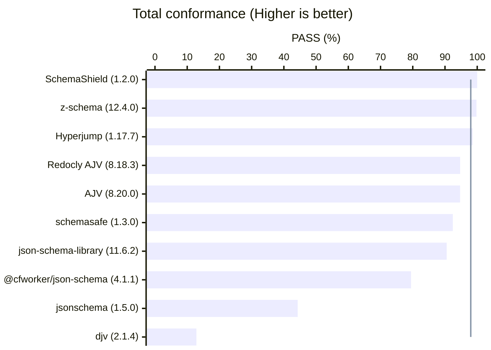
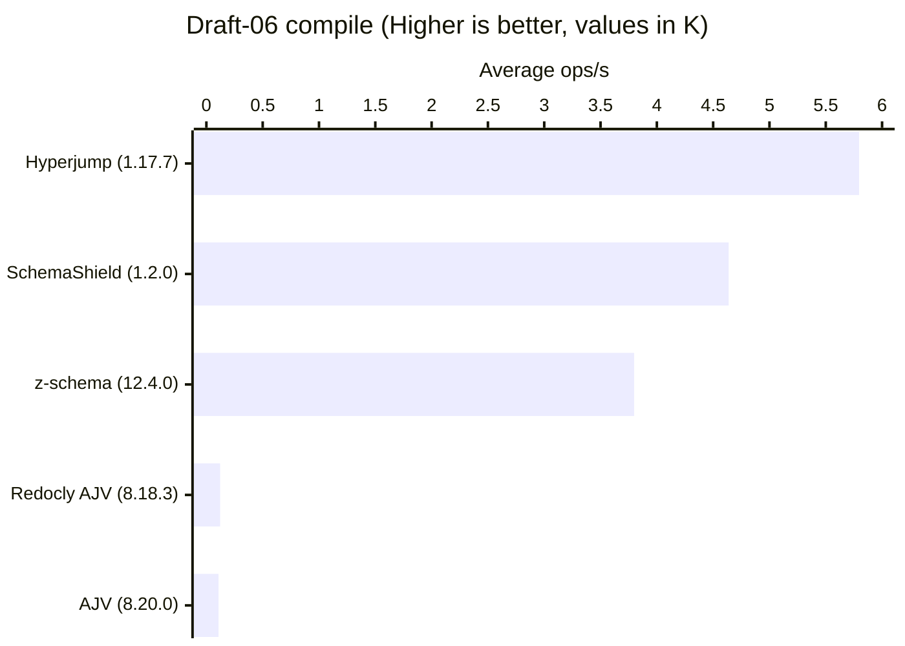
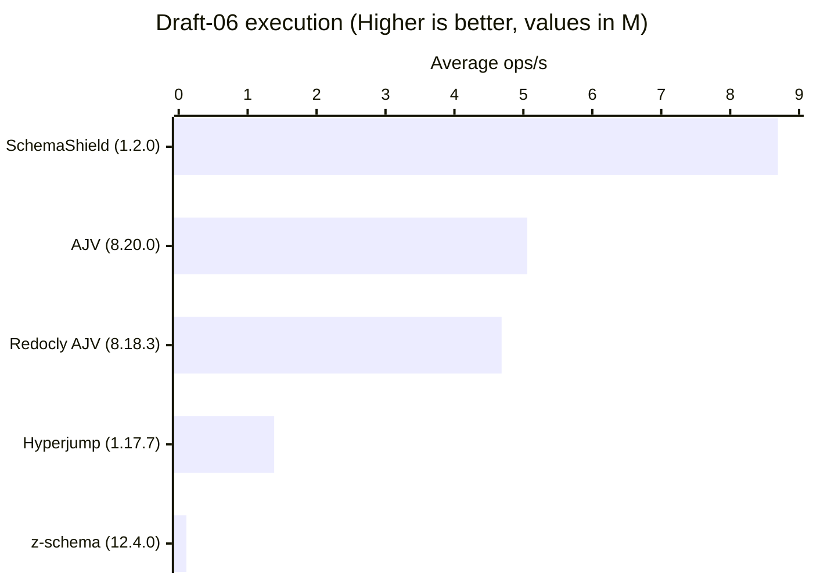
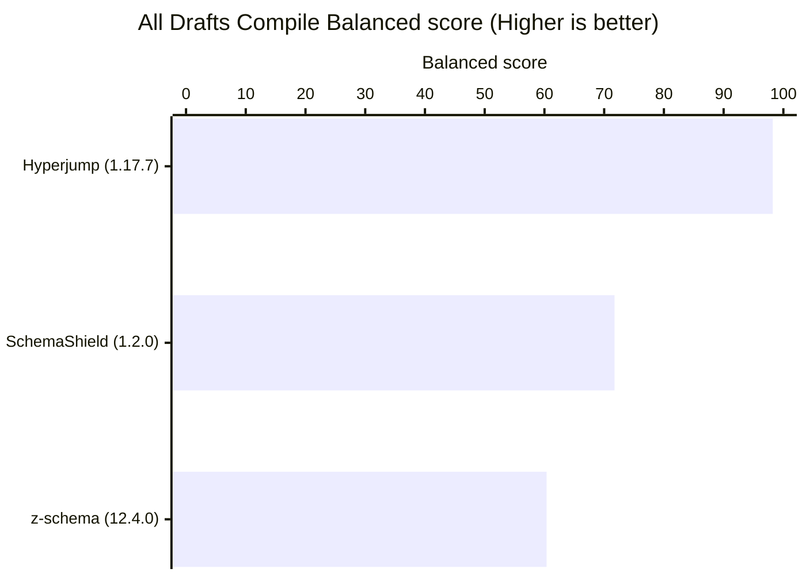
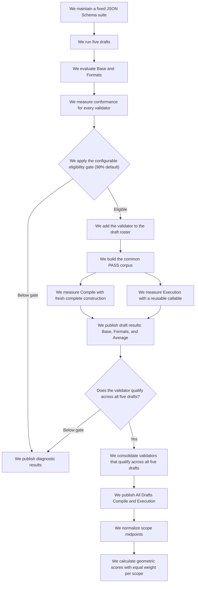

# JSON Schema Validator Bench

## Why

JSON Schema Validator Bench measures conformance and performance across drafts 04, 06, 07, 2019-09, and 2020-12 with pinned dependencies, corpus identities, and report contracts.

Maintainers can reproduce each run, inspect exact conformance records, compare qualified performance scopes, and use the results to target validator improvements.

## Install from a clone

Node.js 22 or later is required. From the cloned project root, install the exact dependency graph from `package-lock.json`:

```bash
git clone <repository-url>
cd <repository-directory>
npm ci
```

Replace `<repository-url>` and `<repository-directory>` with the clone URL and local directory name.

## Root commands

Use Quick for diagnostic change checks. Use Full for canonical publication results. Run Full before publishing.

Run the harness:

```bash
npm test
```

Run Quick:

```bash
npm run benchmark -- --quick
```

Refresh one validator against a compatible Full cohort:

```bash
npm run benchmark -- --validator <canonical-id>
```

Refresh one validator against a compatible Quick cohort:

```bash
npm run benchmark -- --quick --validator <canonical-id>
```

A validator refresh requires a complete compatible publication for the same base mode. Changes to the environment, benchmark contract, suite, locks, threshold, rounds, roster, eligibility, or common PASS corpus require a complete run first.

Set the atomic Base and Formats eligibility threshold with a decimal percentage from 0 through 100:

```bash
npm run benchmark -- --eligibility-threshold-percent 98.5
```

Run Full:

```bash
npm run benchmark
```

## Last run

- **Mode:** Full
- **Completed (UTC):** 2026-08-01T07:06:30.439Z
- **Total duration:** 10 min 7.532 s
- **Node.js version:** v24.18.0
- **OS/platform:** linux 6.8.0-136-generic (x64)
- **CPU:** AMD Ryzen 7 7840HS w/ Radeon 780M Graphics (12 logical cores)
- **System memory total:** 13.5 GiB
- **Peak benchmark RSS:** 311.3 MiB
- **JSON Schema Test Suite commit:** `0c7b65dc16dd8eaa7bd83e21099c76610c3b246a`
- **Eligibility threshold:** 98%
- **Benchmark contract hash:** `735082ce918aba7028dc534b44ddc458215cda534e18bdd1852a9426bad6cefe`

## Total conformance

Eligibility threshold: 98% per draft profile.



| Validator | Draft 4 Base | Draft 4 Formats | Draft 6 Base | Draft 6 Formats | Draft 7 Base | Draft 7 Formats | Draft 2019-09 Base | Draft 2019-09 Formats | Draft 2020-12 Base | Draft 2020-12 Formats | Total |
| --- | ---: | ---: | ---: | ---: | ---: | ---: | ---: | ---: | ---: | ---: | ---: |
| [schema-shield](https://www.npmjs.com/package/schema-shield) (1.2.0) | 99.86% | 100.00% | 100.00% | 100.00% | 100.00% | 100.00% | 100.00% | 100.00% | 100.00% | 100.00% | 99.99% |
| [z-schema](https://www.npmjs.com/package/z-schema) (12.4.0) | 99.72% | 100.00% | 99.89% | 100.00% | 99.90% | 100.00% | 99.51% | 100.00% | 99.52% | 100.00% | 99.77% |
| [hyperjump](https://www.npmjs.com/package/@hyperjump/json-schema) (1.17.7) | 98.33% | 100.00% | 98.52% | 100.00% | 98.28% | 98.98% | 98.24% | 99.08% | 98.28% | 99.10% | 98.59% |
| [redocly-ajv](https://www.npmjs.com/package/@redocly/ajv) (8.18.3) | 98.61% | 99.03% | 98.73% | 99.27% | 98.28% | 85.18% | 97.53% | 86.26% | 95.47% | 85.01% | 94.71% |
| [ajv](https://www.npmjs.com/package/ajv) (8.20.0) | 98.61% | 99.03% | 98.73% | 99.27% | 98.28% | 85.18% | 97.53% | 86.26% | 95.33% | 85.01% | 94.68% |
| [schemasafe](https://www.npmjs.com/package/@exodus/schemasafe) (1.3.0) | 99.30% | 95.15% | 99.58% | 96.34% | 96.94% | 71.72% | 99.08% | 74.05% | 99.04% | 73.16% | 92.43% |
| [json-schema-library](https://www.npmjs.com/package/json-schema-library) (11.6.2) | 98.89% | 56.80% | 99.26% | 65.57% | 98.95% | 70.02% | 99.58% | 72.82% | 99.59% | 73.01% | 90.53% |
| [cfworker-json-schema](https://www.npmjs.com/package/@cfworker/json-schema) (4.1.1) | 98.33% | 97.57% | N/A | N/A | 98.28% | 82.62% | 98.59% | 83.82% | 96.91% | 83.36% | 79.46% |
| [jsonschema](https://www.npmjs.com/package/jsonschema) (1.5.0) | 98.61% | 88.83% | 97.57% | 90.84% | 96.75% | 78.02% | N/A | N/A | N/A | N/A | 44.29% |
| [djv](https://www.npmjs.com/package/djv) (2.1.4) | N/A | N/A | 85.40% | 79.49% | N/A | N/A | N/A | N/A | N/A | N/A | 12.85% |

The line marks the exact 98% draft eligibility threshold. Total uses PASS over all canonical cases. Draft eligibility uses the exact Base and Formats fractions for that draft.

Total means PASS over all 7,970 canonical cases from the five drafts and both profiles. An unsupported draft or scope contributes zero PASS while its cases remain in the denominator. Cells round uniformly to two decimals. The 98% eligibility gate compares exact integer fractions. Rows sort by Total descending with a stable validator ID tie-breaker. Base and Formats must each reach 98% for the participant to qualify in that draft.

## Draft 6 results

### Draft 6 compile

Leader: [hyperjump](https://www.npmjs.com/package/@hyperjump/json-schema) (1.17.7) — 5,796 ops/s (100%)



| Validator | Base ops/s | Formats ops/s | Average ops/s | Score | Base errors | Format errors | Mutations | Peak RSS |
| --- | ---: | ---: | ---: | ---: | ---: | ---: | ---: | ---: |
| [hyperjump](https://www.npmjs.com/package/@hyperjump/json-schema) (1.17.7) | 3,558 | 8,033 | 5,796 | 100% | [6](results/draft6/errors/compile/base/hyperjump-COMPILE.md) | [0](results/draft6/errors/compile/format-assertion/hyperjump-COMPILE.md) | 0 | 271.3 MiB |
| [schema-shield](https://www.npmjs.com/package/schema-shield) (1.2.0) | 3,726 | 5,549 | 4,638 | 80.0% | [0](results/draft6/errors/compile/base/schema-shield-COMPILE.md) | [0](results/draft6/errors/compile/format-assertion/schema-shield-COMPILE.md) | 0 | 268.7 MiB |
| [z-schema](https://www.npmjs.com/package/z-schema) (12.4.0) | 3,387 | 4,209 | 3,798 | 65.5% | [0](results/draft6/errors/compile/base/z-schema-COMPILE.md) | [0](results/draft6/errors/compile/format-assertion/z-schema-COMPILE.md) | 0 | 188.7 MiB |
| [redocly-ajv](https://www.npmjs.com/package/@redocly/ajv) (8.18.3) | 129 | 116 | 122 | 2.1% | [3](results/draft6/errors/compile/base/redocly-ajv-COMPILE.md) | [0](results/draft6/errors/compile/format-assertion/redocly-ajv-COMPILE.md) | 0 | 298.7 MiB |
| [ajv](https://www.npmjs.com/package/ajv) (8.20.0) | 116 | 101 | 108 | 1.9% | [3](results/draft6/errors/compile/base/ajv-COMPILE.md) | [0](results/draft6/errors/compile/format-assertion/ajv-COMPILE.md) | 0 | 293.3 MiB |

Excluded from this ranking:

- [djv](https://www.npmjs.com/package/djv) (2.1.4): PASS_THRESHOLD_NOT_MET(base 807/945 < 98%), PASS_THRESHOLD_NOT_MET(format-assertion 217/273 < 98%).
- [json-schema-library](https://www.npmjs.com/package/json-schema-library) (11.6.2): PASS_THRESHOLD_NOT_MET(format-assertion 179/273 < 98%).
- [jsonschema](https://www.npmjs.com/package/jsonschema) (1.5.0): PHASE_UNAVAILABLE, PASS_THRESHOLD_NOT_MET(base 922/945 < 98%), PASS_THRESHOLD_NOT_MET(format-assertion 248/273 < 98%).
- [schemasafe](https://www.npmjs.com/package/@exodus/schemasafe) (1.3.0): PASS_THRESHOLD_NOT_MET(format-assertion 263/273 < 98%).

### Draft 6 execution

Leader: [schema-shield](https://www.npmjs.com/package/schema-shield) (1.2.0) — 8,693,197 ops/s (100%)



| Validator | Base ops/s | Formats ops/s | Average ops/s | Score | Base errors | Format errors | Mutations | Peak RSS |
| --- | ---: | ---: | ---: | ---: | ---: | ---: | ---: | ---: |
| [schema-shield](https://www.npmjs.com/package/schema-shield) (1.2.0) | 3,569,221 | 13,817,174 | 8,693,197 | 100% | [0](results/draft6/errors/execution/base/schema-shield-RUNTIME.md) | [0](results/draft6/errors/execution/format-assertion/schema-shield-RUNTIME.md) | 0 | 190.2 MiB |
| [ajv](https://www.npmjs.com/package/ajv) (8.20.0) | 5,139,668 | 4,972,764 | 5,056,216 | 58.2% | [0](results/draft6/errors/execution/base/ajv-RUNTIME.md) | [0](results/draft6/errors/execution/format-assertion/ajv-RUNTIME.md) | 0 | 300.5 MiB |
| [redocly-ajv](https://www.npmjs.com/package/@redocly/ajv) (8.18.3) | 4,433,661 | 4,935,008 | 4,684,335 | 53.9% | [0](results/draft6/errors/execution/base/redocly-ajv-RUNTIME.md) | [0](results/draft6/errors/execution/format-assertion/redocly-ajv-RUNTIME.md) | 0 | 311.3 MiB |
| [hyperjump](https://www.npmjs.com/package/@hyperjump/json-schema) (1.17.7) | 670,116 | 2,100,864 | 1,385,490 | 15.9% | [0](results/draft6/errors/execution/base/hyperjump-RUNTIME.md) | [0](results/draft6/errors/execution/format-assertion/hyperjump-RUNTIME.md) | 0 | 193.8 MiB |
| [z-schema](https://www.npmjs.com/package/z-schema) (12.4.0) | 102,575 | 121,714 | 112,145 | 1.3% | [0](results/draft6/errors/execution/base/z-schema-RUNTIME.md) | [0](results/draft6/errors/execution/format-assertion/z-schema-RUNTIME.md) | 0 | 192.0 MiB |

Excluded from this ranking:

- [djv](https://www.npmjs.com/package/djv) (2.1.4): PASS_THRESHOLD_NOT_MET(base 807/945 < 98%), PASS_THRESHOLD_NOT_MET(format-assertion 217/273 < 98%).
- [json-schema-library](https://www.npmjs.com/package/json-schema-library) (11.6.2): PASS_THRESHOLD_NOT_MET(format-assertion 179/273 < 98%).
- [jsonschema](https://www.npmjs.com/package/jsonschema) (1.5.0): PASS_THRESHOLD_NOT_MET(base 922/945 < 98%), PASS_THRESHOLD_NOT_MET(format-assertion 248/273 < 98%).
- [schemasafe](https://www.npmjs.com/package/@exodus/schemasafe) (1.3.0): PASS_THRESHOLD_NOT_MET(format-assertion 263/273 < 98%).

## All drafts results

### All Drafts Compile

Leader: [hyperjump](https://www.npmjs.com/package/@hyperjump/json-schema) (1.17.7) — Balanced score 98.2%



| Validator | Base ops/s | Formats ops/s | Average ops/s | Base score | Formats score | Balanced score |
| --- | ---: | ---: | ---: | ---: | ---: | ---: |
| [hyperjump](https://www.npmjs.com/package/@hyperjump/json-schema) (1.17.7) | 15,386 | 35,861 | 25,624 | 96.5% | 100% | 98.2% |
| [schema-shield](https://www.npmjs.com/package/schema-shield) (1.2.0) | 15,269 | 20,951 | 18,110 | 92.7% | 55.5% | 71.7% |
| [z-schema](https://www.npmjs.com/package/z-schema) (12.4.0) | 13,372 | 16,702 | 15,037 | 81.8% | 44.5% | 60.4% |

Excluded from this ranking:

- [cfworker-json-schema](https://www.npmjs.com/package/@cfworker/json-schema) (4.1.1): coverage 0/10. Reason: draft4/base: PASS_THRESHOLD_NOT_MET(format-assertion 201/206 < 98%). draft4/format-assertion: PASS_THRESHOLD_NOT_MET(format-assertion 201/206 < 98%). draft6/base: DRAFT_UNSUPPORTED. draft6/format-assertion: DRAFT_UNSUPPORTED. draft7/base: PASS_THRESHOLD_NOT_MET(format-assertion 485/587 < 98%). draft7/format-assertion: PASS_THRESHOLD_NOT_MET(format-assertion 485/587 < 98%). draft2019-09/base: PASS_THRESHOLD_NOT_MET(format-assertion 549/655 < 98%). draft2019-09/format-assertion: PASS_THRESHOLD_NOT_MET(format-assertion 549/655 < 98%). draft2020-12/base: PASS_THRESHOLD_NOT_MET(base 1412/1457 < 98%), PASS_THRESHOLD_NOT_MET(format-assertion 556/667 < 98%). draft2020-12/format-assertion: PASS_THRESHOLD_NOT_MET(base 1412/1457 < 98%), PASS_THRESHOLD_NOT_MET(format-assertion 556/667 < 98%).
- [ajv](https://www.npmjs.com/package/ajv) (8.20.0): coverage 4/10. Reason: draft7/base: PASS_THRESHOLD_NOT_MET(format-assertion 500/587 < 98%). draft7/format-assertion: PASS_THRESHOLD_NOT_MET(format-assertion 500/587 < 98%). draft2019-09/base: PASS_THRESHOLD_NOT_MET(base 1382/1417 < 98%), PASS_THRESHOLD_NOT_MET(format-assertion 565/655 < 98%). draft2019-09/format-assertion: PASS_THRESHOLD_NOT_MET(base 1382/1417 < 98%), PASS_THRESHOLD_NOT_MET(format-assertion 565/655 < 98%). draft2020-12/base: PASS_THRESHOLD_NOT_MET(base 1389/1457 < 98%), PASS_THRESHOLD_NOT_MET(format-assertion 567/667 < 98%). draft2020-12/format-assertion: PASS_THRESHOLD_NOT_MET(base 1389/1457 < 98%), PASS_THRESHOLD_NOT_MET(format-assertion 567/667 < 98%).
- [redocly-ajv](https://www.npmjs.com/package/@redocly/ajv) (8.18.3): coverage 4/10. Reason: draft7/base: PASS_THRESHOLD_NOT_MET(format-assertion 500/587 < 98%). draft7/format-assertion: PASS_THRESHOLD_NOT_MET(format-assertion 500/587 < 98%). draft2019-09/base: PASS_THRESHOLD_NOT_MET(base 1382/1417 < 98%), PASS_THRESHOLD_NOT_MET(format-assertion 565/655 < 98%). draft2019-09/format-assertion: PASS_THRESHOLD_NOT_MET(base 1382/1417 < 98%), PASS_THRESHOLD_NOT_MET(format-assertion 565/655 < 98%). draft2020-12/base: PASS_THRESHOLD_NOT_MET(base 1391/1457 < 98%), PASS_THRESHOLD_NOT_MET(format-assertion 567/667 < 98%). draft2020-12/format-assertion: PASS_THRESHOLD_NOT_MET(base 1391/1457 < 98%), PASS_THRESHOLD_NOT_MET(format-assertion 567/667 < 98%).
- [djv](https://www.npmjs.com/package/djv) (2.1.4): coverage 0/10. Reason: draft4/base: DRAFT_UNSUPPORTED. draft4/format-assertion: DRAFT_UNSUPPORTED. draft6/base: PASS_THRESHOLD_NOT_MET(base 807/945 < 98%), PASS_THRESHOLD_NOT_MET(format-assertion 217/273 < 98%). draft6/format-assertion: PASS_THRESHOLD_NOT_MET(base 807/945 < 98%), PASS_THRESHOLD_NOT_MET(format-assertion 217/273 < 98%). draft7/base: DRAFT_UNSUPPORTED. draft7/format-assertion: DRAFT_UNSUPPORTED. draft2019-09/base: DRAFT_UNSUPPORTED. draft2019-09/format-assertion: DRAFT_UNSUPPORTED. draft2020-12/base: DRAFT_UNSUPPORTED. draft2020-12/format-assertion: DRAFT_UNSUPPORTED.
- [json-schema-library](https://www.npmjs.com/package/json-schema-library) (11.6.2): coverage 0/10. Reason: draft4/base: PASS_THRESHOLD_NOT_MET(format-assertion 117/206 < 98%). draft4/format-assertion: PASS_THRESHOLD_NOT_MET(format-assertion 117/206 < 98%). draft6/base: PASS_THRESHOLD_NOT_MET(format-assertion 179/273 < 98%). draft6/format-assertion: PASS_THRESHOLD_NOT_MET(format-assertion 179/273 < 98%). draft7/base: PASS_THRESHOLD_NOT_MET(format-assertion 411/587 < 98%). draft7/format-assertion: PASS_THRESHOLD_NOT_MET(format-assertion 411/587 < 98%). draft2019-09/base: PASS_THRESHOLD_NOT_MET(format-assertion 477/655 < 98%). draft2019-09/format-assertion: PASS_THRESHOLD_NOT_MET(format-assertion 477/655 < 98%). draft2020-12/base: PASS_THRESHOLD_NOT_MET(format-assertion 487/667 < 98%). draft2020-12/format-assertion: PASS_THRESHOLD_NOT_MET(format-assertion 487/667 < 98%).
- [jsonschema](https://www.npmjs.com/package/jsonschema) (1.5.0): coverage 0/10. Reason: draft4/base: PHASE_UNAVAILABLE, PASS_THRESHOLD_NOT_MET(format-assertion 183/206 < 98%). draft4/format-assertion: PHASE_UNAVAILABLE, PASS_THRESHOLD_NOT_MET(format-assertion 183/206 < 98%). draft6/base: PHASE_UNAVAILABLE, PASS_THRESHOLD_NOT_MET(base 922/945 < 98%), PASS_THRESHOLD_NOT_MET(format-assertion 248/273 < 98%). draft6/format-assertion: PHASE_UNAVAILABLE, PASS_THRESHOLD_NOT_MET(base 922/945 < 98%), PASS_THRESHOLD_NOT_MET(format-assertion 248/273 < 98%). draft7/base: PHASE_UNAVAILABLE, PASS_THRESHOLD_NOT_MET(base 1011/1045 < 98%), PASS_THRESHOLD_NOT_MET(format-assertion 458/587 < 98%). draft7/format-assertion: PHASE_UNAVAILABLE, PASS_THRESHOLD_NOT_MET(base 1011/1045 < 98%), PASS_THRESHOLD_NOT_MET(format-assertion 458/587 < 98%). draft2019-09/base: DRAFT_UNSUPPORTED. draft2019-09/format-assertion: DRAFT_UNSUPPORTED. draft2020-12/base: DRAFT_UNSUPPORTED. draft2020-12/format-assertion: DRAFT_UNSUPPORTED.
- [schemasafe](https://www.npmjs.com/package/@exodus/schemasafe) (1.3.0): coverage 0/10. Reason: draft4/base: PASS_THRESHOLD_NOT_MET(format-assertion 196/206 < 98%). draft4/format-assertion: PASS_THRESHOLD_NOT_MET(format-assertion 196/206 < 98%). draft6/base: PASS_THRESHOLD_NOT_MET(format-assertion 263/273 < 98%). draft6/format-assertion: PASS_THRESHOLD_NOT_MET(format-assertion 263/273 < 98%). draft7/base: PASS_THRESHOLD_NOT_MET(base 1013/1045 < 98%), PASS_THRESHOLD_NOT_MET(format-assertion 421/587 < 98%). draft7/format-assertion: PASS_THRESHOLD_NOT_MET(base 1013/1045 < 98%), PASS_THRESHOLD_NOT_MET(format-assertion 421/587 < 98%). draft2019-09/base: PASS_THRESHOLD_NOT_MET(format-assertion 485/655 < 98%). draft2019-09/format-assertion: PASS_THRESHOLD_NOT_MET(format-assertion 485/655 < 98%). draft2020-12/base: PASS_THRESHOLD_NOT_MET(format-assertion 488/667 < 98%). draft2020-12/format-assertion: PASS_THRESHOLD_NOT_MET(format-assertion 488/667 < 98%).

### All Drafts Execution

Leader: [schema-shield](https://www.npmjs.com/package/schema-shield) (1.2.0) — Balanced score 100%


| Validator | Base ops/s | Formats ops/s | Average ops/s | Base score | Formats score | Balanced score |
| --- | ---: | ---: | ---: | ---: | ---: | ---: |
| [schema-shield](https://www.npmjs.com/package/schema-shield) (1.2.0) | 12,164,287 | 69,658,108 | 40,911,198 | 100% | 100% | 100% |
| [hyperjump](https://www.npmjs.com/package/@hyperjump/json-schema) (1.17.7) | 2,384,729 | 4,968,812 | 3,676,770 | 21.5% | 4.6% | 9.9% |
| [z-schema](https://www.npmjs.com/package/z-schema) (12.4.0) | 465,011 | 550,844 | 507,928 | 4.4% | 0.8% | 1.9% |

Excluded from this ranking:

- [cfworker-json-schema](https://www.npmjs.com/package/@cfworker/json-schema) (4.1.1): coverage 0/10. Reason: draft4/base: PASS_THRESHOLD_NOT_MET(format-assertion 201/206 < 98%). draft4/format-assertion: PASS_THRESHOLD_NOT_MET(format-assertion 201/206 < 98%). draft6/base: DRAFT_UNSUPPORTED. draft6/format-assertion: DRAFT_UNSUPPORTED. draft7/base: PASS_THRESHOLD_NOT_MET(format-assertion 485/587 < 98%). draft7/format-assertion: PASS_THRESHOLD_NOT_MET(format-assertion 485/587 < 98%). draft2019-09/base: PASS_THRESHOLD_NOT_MET(format-assertion 549/655 < 98%). draft2019-09/format-assertion: PASS_THRESHOLD_NOT_MET(format-assertion 549/655 < 98%). draft2020-12/base: PASS_THRESHOLD_NOT_MET(base 1412/1457 < 98%), PASS_THRESHOLD_NOT_MET(format-assertion 556/667 < 98%). draft2020-12/format-assertion: PASS_THRESHOLD_NOT_MET(base 1412/1457 < 98%), PASS_THRESHOLD_NOT_MET(format-assertion 556/667 < 98%).
- [ajv](https://www.npmjs.com/package/ajv) (8.20.0): coverage 4/10. Reason: draft7/base: PASS_THRESHOLD_NOT_MET(format-assertion 500/587 < 98%). draft7/format-assertion: PASS_THRESHOLD_NOT_MET(format-assertion 500/587 < 98%). draft2019-09/base: PASS_THRESHOLD_NOT_MET(base 1382/1417 < 98%), PASS_THRESHOLD_NOT_MET(format-assertion 565/655 < 98%). draft2019-09/format-assertion: PASS_THRESHOLD_NOT_MET(base 1382/1417 < 98%), PASS_THRESHOLD_NOT_MET(format-assertion 565/655 < 98%). draft2020-12/base: PASS_THRESHOLD_NOT_MET(base 1389/1457 < 98%), PASS_THRESHOLD_NOT_MET(format-assertion 567/667 < 98%). draft2020-12/format-assertion: PASS_THRESHOLD_NOT_MET(base 1389/1457 < 98%), PASS_THRESHOLD_NOT_MET(format-assertion 567/667 < 98%).
- [redocly-ajv](https://www.npmjs.com/package/@redocly/ajv) (8.18.3): coverage 4/10. Reason: draft7/base: PASS_THRESHOLD_NOT_MET(format-assertion 500/587 < 98%). draft7/format-assertion: PASS_THRESHOLD_NOT_MET(format-assertion 500/587 < 98%). draft2019-09/base: PASS_THRESHOLD_NOT_MET(base 1382/1417 < 98%), PASS_THRESHOLD_NOT_MET(format-assertion 565/655 < 98%). draft2019-09/format-assertion: PASS_THRESHOLD_NOT_MET(base 1382/1417 < 98%), PASS_THRESHOLD_NOT_MET(format-assertion 565/655 < 98%). draft2020-12/base: PASS_THRESHOLD_NOT_MET(base 1391/1457 < 98%), PASS_THRESHOLD_NOT_MET(format-assertion 567/667 < 98%). draft2020-12/format-assertion: PASS_THRESHOLD_NOT_MET(base 1391/1457 < 98%), PASS_THRESHOLD_NOT_MET(format-assertion 567/667 < 98%).
- [djv](https://www.npmjs.com/package/djv) (2.1.4): coverage 0/10. Reason: draft4/base: DRAFT_UNSUPPORTED. draft4/format-assertion: DRAFT_UNSUPPORTED. draft6/base: PASS_THRESHOLD_NOT_MET(base 807/945 < 98%), PASS_THRESHOLD_NOT_MET(format-assertion 217/273 < 98%). draft6/format-assertion: PASS_THRESHOLD_NOT_MET(base 807/945 < 98%), PASS_THRESHOLD_NOT_MET(format-assertion 217/273 < 98%). draft7/base: DRAFT_UNSUPPORTED. draft7/format-assertion: DRAFT_UNSUPPORTED. draft2019-09/base: DRAFT_UNSUPPORTED. draft2019-09/format-assertion: DRAFT_UNSUPPORTED. draft2020-12/base: DRAFT_UNSUPPORTED. draft2020-12/format-assertion: DRAFT_UNSUPPORTED.
- [json-schema-library](https://www.npmjs.com/package/json-schema-library) (11.6.2): coverage 0/10. Reason: draft4/base: PASS_THRESHOLD_NOT_MET(format-assertion 117/206 < 98%). draft4/format-assertion: PASS_THRESHOLD_NOT_MET(format-assertion 117/206 < 98%). draft6/base: PASS_THRESHOLD_NOT_MET(format-assertion 179/273 < 98%). draft6/format-assertion: PASS_THRESHOLD_NOT_MET(format-assertion 179/273 < 98%). draft7/base: PASS_THRESHOLD_NOT_MET(format-assertion 411/587 < 98%). draft7/format-assertion: PASS_THRESHOLD_NOT_MET(format-assertion 411/587 < 98%). draft2019-09/base: PASS_THRESHOLD_NOT_MET(format-assertion 477/655 < 98%). draft2019-09/format-assertion: PASS_THRESHOLD_NOT_MET(format-assertion 477/655 < 98%). draft2020-12/base: PASS_THRESHOLD_NOT_MET(format-assertion 487/667 < 98%). draft2020-12/format-assertion: PASS_THRESHOLD_NOT_MET(format-assertion 487/667 < 98%).
- [jsonschema](https://www.npmjs.com/package/jsonschema) (1.5.0): coverage 0/10. Reason: draft4/base: PASS_THRESHOLD_NOT_MET(format-assertion 183/206 < 98%). draft4/format-assertion: PASS_THRESHOLD_NOT_MET(format-assertion 183/206 < 98%). draft6/base: PASS_THRESHOLD_NOT_MET(base 922/945 < 98%), PASS_THRESHOLD_NOT_MET(format-assertion 248/273 < 98%). draft6/format-assertion: PASS_THRESHOLD_NOT_MET(base 922/945 < 98%), PASS_THRESHOLD_NOT_MET(format-assertion 248/273 < 98%). draft7/base: PASS_THRESHOLD_NOT_MET(base 1011/1045 < 98%), PASS_THRESHOLD_NOT_MET(format-assertion 458/587 < 98%). draft7/format-assertion: PASS_THRESHOLD_NOT_MET(base 1011/1045 < 98%), PASS_THRESHOLD_NOT_MET(format-assertion 458/587 < 98%). draft2019-09/base: DRAFT_UNSUPPORTED. draft2019-09/format-assertion: DRAFT_UNSUPPORTED. draft2020-12/base: DRAFT_UNSUPPORTED. draft2020-12/format-assertion: DRAFT_UNSUPPORTED.
- [schemasafe](https://www.npmjs.com/package/@exodus/schemasafe) (1.3.0): coverage 0/10. Reason: draft4/base: PASS_THRESHOLD_NOT_MET(format-assertion 196/206 < 98%). draft4/format-assertion: PASS_THRESHOLD_NOT_MET(format-assertion 196/206 < 98%). draft6/base: PASS_THRESHOLD_NOT_MET(format-assertion 263/273 < 98%). draft6/format-assertion: PASS_THRESHOLD_NOT_MET(format-assertion 263/273 < 98%). draft7/base: PASS_THRESHOLD_NOT_MET(base 1013/1045 < 98%), PASS_THRESHOLD_NOT_MET(format-assertion 421/587 < 98%). draft7/format-assertion: PASS_THRESHOLD_NOT_MET(base 1013/1045 < 98%), PASS_THRESHOLD_NOT_MET(format-assertion 421/587 < 98%). draft2019-09/base: PASS_THRESHOLD_NOT_MET(format-assertion 485/655 < 98%). draft2019-09/format-assertion: PASS_THRESHOLD_NOT_MET(format-assertion 485/655 < 98%). draft2020-12/base: PASS_THRESHOLD_NOT_MET(format-assertion 488/667 < 98%). draft2020-12/format-assertion: PASS_THRESHOLD_NOT_MET(format-assertion 488/667 < 98%).

## How to read these results

Draft tables use the arithmetic Average of their Base and Formats midpoints. The relative Score divides that draft-level Average by the best Average in the same phase and multiplies the ratio by 100.

All-drafts tables show three raw aggregated indices before the normalized scores. Base ops/s sums the 5 Base midpoints, Formats ops/s sums the 5 Formats midpoints, and Average ops/s equals their arithmetic mean. These columns inherit ops/s units from their scope midpoints. Base score and Formats score use normalized geometric means across 5 scopes. Balanced score uses all 10 scopes and alone determines the leader and row order.

Compile error links open COMPILE records. Execution error links open RUNTIME records.

N/A marks an unavailable measurement. Compile N/A identifies a validate-only API or unavailable compile measurement.

Draft charts plot measured Average ops/s values. All-drafts charts plot Balanced score rather than the raw Average ops/s index. Draft tables retain N/A entries, while all-drafts eligibility excludes incomplete participants.

## Detailed draft summaries

- [draft4 detailed summary](results/draft4/summary.md)
- [draft6 detailed summary](results/draft6/summary.md)
- [draft7 detailed summary](results/draft7/summary.md)
- [draft2019-09 detailed summary](results/draft2019-09/summary.md)
- [draft2020-12 detailed summary](results/draft2020-12/summary.md)

## Methodology

### Participants

Period: 2026-07-20 through 2026-07-26. Retrieved at 2026-07-31T05:01:12.902Z.

Weekly downloads show npm adoption volume for the snapshot period.

| Validator | Weekly downloads |
| --- | ---: |
| [ajv](https://www.npmjs.com/package/ajv) (8.20.0) | 351,242,149 |
| [cfworker-json-schema](https://www.npmjs.com/package/@cfworker/json-schema) (4.1.1) | 5,891,999 |
| [djv](https://www.npmjs.com/package/djv) (2.1.4) | 81,251 |
| [hyperjump](https://www.npmjs.com/package/@hyperjump/json-schema) (1.17.7) | 247,240 |
| [json-schema-library](https://www.npmjs.com/package/json-schema-library) (11.6.2) | 513,747 |
| [jsonschema](https://www.npmjs.com/package/jsonschema) (1.5.0) | 6,227,344 |
| [redocly-ajv](https://www.npmjs.com/package/@redocly/ajv) (8.18.3) | 7,551,204 |
| [schema-shield](https://www.npmjs.com/package/schema-shield) (1.2.0) | 261 |
| [schemasafe](https://www.npmjs.com/package/@exodus/schemasafe) (1.3.0) | 4,742,721 |
| [z-schema](https://www.npmjs.com/package/z-schema) (12.4.0) | 3,436,312 |

### Participants by draft

Every participant listed for a draft runs conformance in both `base` and `format-assertion`. One atomic roster per draft governs both profiles. Compile intersects that roster with participants that expose Compile capability. Participant links use the package names recorded in `results/packages.json` and verified against npm.

- **draft4:** [cfworker-json-schema](https://www.npmjs.com/package/@cfworker/json-schema) (4.1.1), [ajv](https://www.npmjs.com/package/ajv) (8.20.0), [hyperjump](https://www.npmjs.com/package/@hyperjump/json-schema) (1.17.7), [redocly-ajv](https://www.npmjs.com/package/@redocly/ajv) (8.18.3), [schema-shield](https://www.npmjs.com/package/schema-shield) (1.2.0), [json-schema-library](https://www.npmjs.com/package/json-schema-library) (11.6.2), [jsonschema](https://www.npmjs.com/package/jsonschema) (1.5.0), [schemasafe](https://www.npmjs.com/package/@exodus/schemasafe) (1.3.0), [z-schema](https://www.npmjs.com/package/z-schema) (12.4.0)
- **draft6:** [ajv](https://www.npmjs.com/package/ajv) (8.20.0), [hyperjump](https://www.npmjs.com/package/@hyperjump/json-schema) (1.17.7), [redocly-ajv](https://www.npmjs.com/package/@redocly/ajv) (8.18.3), [schema-shield](https://www.npmjs.com/package/schema-shield) (1.2.0), [djv](https://www.npmjs.com/package/djv) (2.1.4), [json-schema-library](https://www.npmjs.com/package/json-schema-library) (11.6.2), [jsonschema](https://www.npmjs.com/package/jsonschema) (1.5.0), [schemasafe](https://www.npmjs.com/package/@exodus/schemasafe) (1.3.0), [z-schema](https://www.npmjs.com/package/z-schema) (12.4.0)
- **draft7:** [cfworker-json-schema](https://www.npmjs.com/package/@cfworker/json-schema) (4.1.1), [ajv](https://www.npmjs.com/package/ajv) (8.20.0), [hyperjump](https://www.npmjs.com/package/@hyperjump/json-schema) (1.17.7), [redocly-ajv](https://www.npmjs.com/package/@redocly/ajv) (8.18.3), [schema-shield](https://www.npmjs.com/package/schema-shield) (1.2.0), [json-schema-library](https://www.npmjs.com/package/json-schema-library) (11.6.2), [jsonschema](https://www.npmjs.com/package/jsonschema) (1.5.0), [schemasafe](https://www.npmjs.com/package/@exodus/schemasafe) (1.3.0), [z-schema](https://www.npmjs.com/package/z-schema) (12.4.0)
- **draft2019-09:** [cfworker-json-schema](https://www.npmjs.com/package/@cfworker/json-schema) (4.1.1), [ajv](https://www.npmjs.com/package/ajv) (8.20.0), [hyperjump](https://www.npmjs.com/package/@hyperjump/json-schema) (1.17.7), [redocly-ajv](https://www.npmjs.com/package/@redocly/ajv) (8.18.3), [schema-shield](https://www.npmjs.com/package/schema-shield) (1.2.0), [json-schema-library](https://www.npmjs.com/package/json-schema-library) (11.6.2), [schemasafe](https://www.npmjs.com/package/@exodus/schemasafe) (1.3.0), [z-schema](https://www.npmjs.com/package/z-schema) (12.4.0)
- **draft2020-12:** [cfworker-json-schema](https://www.npmjs.com/package/@cfworker/json-schema) (4.1.1), [ajv](https://www.npmjs.com/package/ajv) (8.20.0), [hyperjump](https://www.npmjs.com/package/@hyperjump/json-schema) (1.17.7), [redocly-ajv](https://www.npmjs.com/package/@redocly/ajv) (8.18.3), [schema-shield](https://www.npmjs.com/package/schema-shield) (1.2.0), [json-schema-library](https://www.npmjs.com/package/json-schema-library) (11.6.2), [schemasafe](https://www.npmjs.com/package/@exodus/schemasafe) (1.3.0), [z-schema](https://www.npmjs.com/package/z-schema) (12.4.0)

### Profiles

For draft4, draft6 and draft7, `base` contains the standard suite outside the official optional format assertion directories, including each draft's core format behavior. `format-assertion` contains the official `optional/format/*` cases.

For draft2019-09 and draft2020-12, `base` treats `format` as an annotation. `format-assertion` enables the official optional format assertion cases. Draft2020-12 also includes its `optional/format-assertion` suite in that profile.



### Conformance and common PASS corpus

We measure conformance for every configured validator against every discovered case in Base and Formats. We preserve each `PASS`, `WRONG`, `COMPILE`, `RUNTIME` and `UNSUPPORTED` result in the reports and participant matrix.

We calculate the Base and Formats PASS fractions independently. We compare exact integer fractions and require each fraction to reach the configured 98% gate. Every non-PASS status reduces its profile fraction. We add a validator to one atomic draft roster when both profiles reach the gate. Execution uses that roster directly, while Compile intersects it with validators that expose Compile capability.

We retain every excluded validator and its exact reasons in diagnostic results. We build each common phase corpus from cases where every validator in that phase roster reports `PASS`. A ranking requires at least two qualified competitors. Smaller rosters publish `INSUFFICIENT_COMPETITORS`; competitive leader, relative score, and chart fields start with two competitors.

We publish two hashes for each phase intersection. The performance identity hash covers the policy, relevant suite and format configuration, eligible roster, and common corpus. Compatible performance cache entries share this identity. The artifact hash also covers excluded-roster diagnostics, mutations, and all source-report hashes.

### Compile

We measure one complete fresh construction per Compile operation: adapter factory and context creation, vendor construction, format and metaschema registration, resource registration, and schema compilation. We prepare the neutral corpus and disposable schema and resource copies before the clock starts. Primitive schemas, including `true` and `false`, enter each fresh adapter directly. Compile `N/A` identifies a validate-only API or unavailable compile measurement.

### Execution

We prepare each reusable callable and its correctness-check data before the Execution clock starts. We then measure complete passes over the common corpus with one isolated mutable measurement set per worker and round. `reusable-sync` exposes synchronous compilation, `reusable-async` resolves asynchronous setup before reuse, and `validate-only` calls validation directly through the vendor API. Any boolean result change or memory-budget violation fails the sample.

### Timing and scoring

In Full mode, we evaluate every discovered conformance case and measure the complete common corpus. We keep integrity checks and baseline resets outside operation clocks. We warm complete corpus passes for at least 100 ms, then measure complete passes toward a 500 ms target with a normal minimum of 350 ms. Each active validator receives two isolated samples in canonical-name order with validator ID as the deterministic tie-breaker.

Higher ops/s is better. Each scope reports both rounds, their range, and their arithmetic midpoint. We calculate the scoped relative Score as `midpoint / bestMidpoint * 100`, a normalized relative performance index. Statistical significance and percentage improvement require separate analysis. The best scoped midpoint scores exactly 100%, and rows sort by midpoint ops/s descending with validator ID for deterministic ties.

Draft tables retain the arithmetic Average of their Base and Formats midpoints for one draft and phase. In All Drafts tables, Base ops/s and Formats ops/s sum five scope midpoints, and Average ops/s is the arithmetic mean of those sums. All three are raw aggregated indices with inherited ops/s units. Complete traversal throughput remains scoped to each draft and profile. We keep N/A measurements last.

For All Drafts, we require atomic eligibility at 98% in Base and Formats across all five drafts. We set each phase-and-scope reference to the fastest midpoint in the common All Drafts roster and divide each validator midpoint by that reference. We calculate Base score and Formats score as five-scope geometric means, then calculate Balanced score as the ten-scope geometric mean with equal weight per scope. Balanced score also equals `sqrt(Base score * Formats score)` within floating-point precision. Balanced score determines the leader and row order, with validator ID as the deterministic tie-breaker. The raw indices provide context. A validator scores 100 only by matching every relevant scope reference. The highest All Drafts score can therefore be below 100.

### Mutations

Conformance detects schema, data, and resource mutations on disposable copies. We deduplicate findings by `(validator, draft, scope, subjectId, mutationTarget, mutationClass, difference)` and retain every event in JSON. Each validator report renders the first 10 findings in deterministic order, states its omitted count, and links readers to the complete JSON record. Performance Compile and Execution use separate copies. Performance rankings use throughput and score metrics.

### Memory

We record Peak RSS as the maximum absolute resident-set size across valid rounds in a scope. Draft tables take the maximum across profiles, while All Drafts JSON takes the maximum across all valid scopes. Markdown renders MiB, JSON stores integer bytes as `peakRssBytes`, and missing samples remain `N/A`. Rankings and charts use throughput and score metrics.

### Reproducibility

We pin the npm dependency graph, npm metadata snapshot, and JSON Schema Test Suite commit and tree. We keep the suite checkout and resumable checkpoints under `.cache/`, and we record package, corpus, intersection and sample hashes in the generated artifacts.

On a clean clone, we use `npm ci` for exact dependencies and `npm test` for the local suite. `npm run benchmark` prepares the pinned suite checkout and runs Full. The `--quick` flag uses the same suite with a reduced performance corpus. Only `npm run metadata:sync` refreshes npm metadata. We stage and validate Quick diagnostics or the Full publication contract before a coordinated transactional publication of `README.md` and `results/`. The transaction rolls back failures before both paths commit. Because the public layout has two root paths, concurrent readers can observe the rename window.

Canonical results come from a controlled Linux host. CI validates tests and artifact integrity. Record the environment and benchmark contract hash for every published run.

## Status definitions

- `PASS`: observed validation matches the suite expectation.
- `WRONG`: the validator returned the opposite boolean.
- `COMPILE`: the reusable profile rejected the schema.
- `RUNTIME`: validation threw or fast and detailed profiles diverged.
- `UNSUPPORTED`: the common preflight or adapter declared a known unsupported capability.

The global conformance table reports PASS percentage for every draft and profile. Total divides PASS by the complete canonical denominator across all five drafts and both profiles. Unsupported scopes contribute zero PASS and keep their cases in the denominator. Rows sort by Total descending with validator ID as the stable tie-breaker.

## Results

- `results/index.json` records the result format, benchmark mode, drafts and profiles.
- `results/environment.json` records runtime and hashes.
- `results/packages.json` records package versions, tarballs, and integrities.
- `results/validators.json` records validator profiles.
- `results/global-summary.json` records one All Drafts ranking per phase with raw draft midpoints, summed Base and Formats ops/s indices, their arithmetic Average ops/s index, per-scope references, geometric Base, Formats and Balanced scores, mutation counts, peak RSS bytes, eligibility and exclusions.
- `results/global-errors/` contains the exact records summed by each linked all-drafts error count, including explicit zero-record pages.
- `results/mutations/` contains one bounded Markdown mutation report for each validator with recorded mutations plus a hashed inventory. Each report renders at most 10 deterministic event details while its total and the JSON results remain complete.
- `results/<draft>/conformance/` contains full JSON and Markdown reports.
- `results/<draft>/profiles/<profile>/intersections/` contains phase-specific eligibility, rosters, hashes, intersections, and retention data.
- `results/<draft>/profiles/<profile>/<phase>/` contains raw phase samples and summaries for the exact eligible roster.
- `results/<draft>/summary.md` contains rankings per profile.
- `results/summary.md` indexes all configured drafts.

## Contributing

[Read the contribution guide](contribute.md)

## Licensing and third-party materials

Original code and documentation are Copyright Masquerade Circus and licensed under [Apache-2.0](LICENSE).

The benchmark corpus comes from the JSON Schema Test Suite. JSON Schema Test Suite commit: `0c7b65dc16dd8eaa7bd83e21099c76610c3b246a`. Copyright (c) 2012 Julian Berman. The corpus remains under the MIT License. See [THIRD_PARTY_NOTICES](THIRD_PARTY_NOTICES) for its full terms and attribution.

Dependencies, bundled metaschema snapshots, and other third-party materials retain their own licenses. The third-party notices also point to the existing AJV and Redocly AJV metaschema notices.
